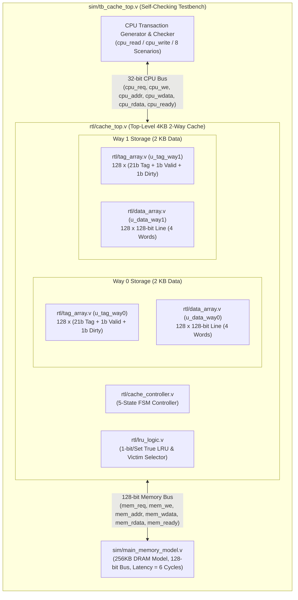

# Đồ Án Kiến Trúc Máy Tính: Thiết Kế Bộ Nhớ Đệm 4KB 2-Way Set-Associative Cache Controller (Verilog RTL)

Dự án này thiết kế, hiện thực hóa phần cứng ở mức **RTL (Register-Transfer Level)** bằng ngôn ngữ **Verilog HDL** và kiểm chứng toàn diện bộ điều khiển bộ nhớ đệm **4KB 2-Way Set-Associative Cache** theo chuẩn kiến trúc bộ nhớ phân cấp trong giáo trình kinh điển *Computer Organization and Design* (David A. Patterson & John L. Hennessy – Chương 5, Mục 5.3 – 5.5).

---

## Mục Lục

1. [Thông Số Kỹ Thuật Kiến Trúc (Architecture Specifications)](#1-thông-số-kỹ-thuật-kiến-trúc-architecture-specifications)
2. [Cấu Trúc Dự Án (Project Structure)](#2-cấu-trúc-dự-án-project-structure)
3. [Vai Trò Chi Tiết Của Các File Trong Dự Án](#3-vai-trò-chi-tiết-của-các-file-trong-dự-án)
4. [Hướng Dẫn Sử Dụng Chi Tiết (Usage Guide)](#4-hướng-dẫn-sử-dụng-chi-tiết-usage-guide)
5. [Tóm Tắt Kết Quả Kiểm Thử Phần Cứng (Verification Summary)](#5-tóm-tắt-kết-quả-kiểm-thử-phần-cứng-verification-summary)
6. [Lộ Trình Đọc Tài Liệu Học Thuật & Bảo Vệ Đồ Án](#6-lộ-trình-đọc-tài-liệu-học-thuật--bảo-vệ-đồ-án)

---

## 1. Thông Số Kỹ Thuật Kiến Trúc (Architecture Specifications)

| Thông số kỹ thuật | Giá trị thiết kế | Giải thích chi tiết |
| :--- | :--- | :--- |
| **Dung lượng dữ liệu (Cache Capacity)** | `4 KB` (`4,096 Bytes`) | Không tính phần bù (overhead) của Tag, Valid, Dirty, LRU |
| **Kích thước dòng (Cache Line / Block Size)** | `16 Bytes` (`128 bits`) | Mỗi dòng chứa `4 Words` (mỗi Word `32 bits`) |
| **Độ kết hợp (Associativity)** | `2-Way Set-Associative` | Mỗi tập hợp (Set) gồm 2 đường (`Way 0` và `Way 1`) |
| **Tổng số dòng (Total Cache Lines)** | `256 Lines` | $4096 \text{ Bytes} / 16 \text{ Bytes} = 256 \text{ Lines}$ |
| **Tổng số tập hợp (Number of Sets)** | `128 Sets` | $256 \text{ Lines} / 2 \text{ Ways} = 128 \text{ Sets}$ (`Set 0` $\to$ `Set 127`) |
| **Độ rộng địa chỉ (Address Width)** | `32-bit Byte Address` | Phân tách: `Tag [31:11]` (21b) \| `Index [10:4]` (7b) \| `Word [3:2]` (2b) \| `Byte [1:0]` (2b) |
| **Chính sách Ghi Hit (Write Hit Policy)** | **Write-Back** | Chỉ cập nhật vào Cache và bật cờ `Dirty = 1`; chỉ ghi trả về DRAM khi dòng đó bị trục xuất (Eviction) |
| **Chính sách Ghi Miss (Write Miss Policy)** | **Write-Allocate** | Nạp toàn bộ dòng 128-bit từ DRAM lên Cache, trộn (merge) Word 32-bit mới vào và đánh dấu `Dirty = 1` |
| **Thuật toán Thay thế (Replacement Policy)** | **True LRU (1-bit/Set)** | Ưu tiên cấp phát vào Way đang trống (`Valid = 0`); nếu cả 2 Way đều đầy thì thay thế Way ít được dùng gần đây nhất |
| **Độ trễ Truy cập (Access Latency)** | Hit: `1 chu kỳ` | Clean Miss: `10 chu kỳ` \| Dirty Miss (có Write-Back): `18 chu kỳ` (với DRAM Latency = 6 chu kỳ) |

---

## 2. Cấu Trúc Dự Án (Project Structure)

### 2.1. Sơ Đồ Cây Thư Mục

Dự án được tổ chức theo cấu trúc chuẩn của quy trình thiết kế vi mạch số (ASIC/FPGA RTL Design & Verification):

```text
project_KTMT/
├── rtl/                                      # [1] Mã nguồn phần cứng Verilog RTL (Synthesizable)
│   ├── cache_defines.vh                      # Header định nghĩa hằng số kiến trúc, trường bit địa chỉ & mã hóa FSM
│   ├── cache_top.v                           # Module Top-level tích hợp Controller, 2x Tag Array, 2x Data Array & LRU
│   ├── cache_controller.v                    # Máy trạng thái hữu hạn (FSM 5 trạng thái) điều khiển toàn bộ Cache
│   ├── tag_array.v                           # Mảng SRAM lưu trữ Tag (21-bit), Valid (1-bit) và Dirty (1-bit) cho 1 Way
│   ├── data_array.v                          # Mảng SRAM lưu trữ Dữ liệu (128 dòng x 128-bit) hỗ trợ ghi Line & ghi Word
│   └── lru_logic.v                           # Khối logic theo dõi bit LRU và lựa chọn đường nạn nhân (Victim Way)
│
├── sim/                                      # [2] Môi trường mô phỏng & Kiểm thử tự động (Self-Checking Verification)
│   ├── main_memory_model.v                   # Mô hình hành vi Bộ nhớ chính (DRAM) bus 128-bit, độ trễ cấu hình được
│   ├── tb_cache_top.v                        # Testbench tự động kiểm tra 8 kịch bản chuyên sâu & báo cáo AMAT/Stall
│   └── cache_sim.out                         # File thực thi mô phỏng biên dịch bởi Icarus Verilog
│
├── scripts/                                  # [3] Công cụ tự động hóa biên dịch, mô phỏng & Mô hình chuẩn Python
│   ├── run_sim.ps1                           # Script PowerShell biên dịch & chạy mô phỏng (hỗ trợ mở GTKWave)
│   ├── run_sim.bat                           # Script Batch chạy nhanh bằng 1 cú click trên Windows
│   └── cache_architectural_suite.py          # Golden Model kiểm chứng chéo RTL, phân tích DGEMM Blocking & Hamming ECC
│
├── docs/                                     # [4] Hệ thống tài liệu học thuật & kỹ thuật chi tiết bằng tiếng Việt
│   ├── 01_Co_So_Ly_Thuyet_Bo_Nho_Dem_Cache.md
│   ├── 02_Thiet_Ke_Vi_Kien_Truc_RTL_va_FSM.md
│   └── 03_Kiem_Thu_Phan_Tich_Ket_Qua_va_Cau_Hoi_Bao_Ve.md
│
├── 5.3-5.4.pdf                               # Tài liệu tham khảo gốc (Patterson & Hennessy - Chương 5: Mục 5.3 - 5.5)
├── cache_sim.vcd                             # File dạng sóng (Value Change Dump) xuất ra từ quá trình mô phỏng
└── README.md                                 # Tài liệu hướng dẫn tổng quan dự án (file hiện tại)
```

### 2.2. Sơ Đồ Phân Cấp Module Phần Cứng & Môi Trường Kiểm Thử



---

## 3. Vai Trò Chi Tiết Của Các File Trong Dự Án

### 3.1. Nhóm Mã Nguồn Phần Cứng RTL (`rtl/`)

Toàn bộ các file trong thư mục `rtl/` được viết bằng Verilog chuẩn tổng hợp được (**Synthesizable RTL**), tách biệt rõ ràng giữa đường điều khiển (**Control Path**) và đường dữ liệu (**Datapath**):

| File | Vai trò & Chức năng chi tiết |
| :--- | :--- |
| [`rtl/cache_defines.vh`](file:///c:/Users/LAM%20QUY%20DO/Downloads/project_KTMT/rtl/cache_defines.vh) | **File Header định nghĩa tham số toàn cục**:<br>• Định nghĩa kích thước kiến trúc: `ADDR_WIDTH = 32`, `DATA_WIDTH = 32`, `LINE_WIDTH = 128`, `NUM_WAYS = 2`, `NUM_SETS = 128`.<br>• Định nghĩa vị trí cắt bit địa chỉ: `Tag [31:11]` (21 bits), `Index [10:4]` (7 bits), `Word Select [3:2]` (2 bits), `Byte Offset [1:0]` (2 bits).<br>• Định nghĩa mã hóa 5 trạng thái của FSM (`STATE_IDLE = 3'b000` đến `STATE_REFILL_UPDATE = 3'b100`). |
| [`rtl/cache_top.v`](file:///c:/Users/LAM%20QUY%20DO/Downloads/project_KTMT/rtl/cache_top.v) | **Module Top-Level của bộ nhớ đệm (`cache_top`)**:<br>• Là giao diện kết nối trực tiếp với CPU (bus dữ liệu 32-bit) và Bộ nhớ chính DRAM (bus khối 128-bit).<br>• Khởi tạo và kết nối 6 thực thể con: 1 khối `cache_controller`, 2 khối `tag_array` (`u_tag_way0`, `u_tag_way1`), 2 khối `data_array` (`u_data_way0`, `u_data_way1`) và 1 khối `lru_logic`.<br>• Thực hiện mạch tổ hợp so sánh Tag song song trên cả 2 Way (`hit0`, `hit1`), điều khiển bộ chọn kênh (MUX) xuất dữ liệu đọc `cpu_rdata` (từ SRAM khi Hit hoặc từ bộ đệm `refill_line` khi vừa nạp xong từ DRAM). |
| [`rtl/cache_controller.v`](file:///c:/Users/LAM%20QUY%20DO/Downloads/project_KTMT/rtl/cache_controller.v) | **Bộ điều khiển trung tâm (`cache_controller`)**:<br>• Hiện thực máy trạng thái hữu hạn **5 trạng thái**: `STATE_IDLE` (chờ yêu cầu), `STATE_COMPARE_TAG` (kiểm tra Hit/Miss trong 1 chu kỳ), `STATE_WRITE_BACK` (ghi dòng bẩn 128-bit về DRAM), `STATE_FETCH_MEM` (đọc dòng mới 128-bit từ DRAM) và `STATE_REFILL_UPDATE` (cập nhật SRAM và trả dữ liệu cho CPU).<br>• Chốt (latch) địa chỉ/dữ liệu của CPU và thông tin đường nạn nhân (`latched_victim_way`, `latched_victim_tag`, `latched_victim_data`) để đảm bảo an toàn tín hiệu trong suốt quá trình xử lý Miss.<br>• Thực thi chính sách **Write-Back** và **Write-Allocate** (tự động trộn từ 32-bit của CPU vào dòng 128-bit vừa tải từ DRAM khi xảy ra Write Miss). |
| [`rtl/tag_array.v`](file:///c:/Users/LAM%20QUY%20DO/Downloads/project_KTMT/rtl/tag_array.v) | **Mảng lưu trữ Tag và Cờ trạng thái (`tag_array`) cho 1 Way**:<br>• Chứa 3 mảng thanh ghi `128 phần tử`: `tag_mem` (21-bit), `valid_mem` (1-bit) và `dirty_mem` (1-bit).<br>• **Đọc bất đồng bộ (Combinational Read)**: Xuất ngay `tag_out`, `valid_out`, `dirty_out` theo chỉ số `index` để so sánh Tag ngay trong chu kỳ `STATE_COMPARE_TAG`.<br>• **Ghi đồng bộ (Synchronous Write)**: Cập nhật Tag mới kèm bật cờ `Valid = 1` khi có xung `tag_we`, và cập nhật cờ `Dirty` khi có xung `dirty_we`. |
| [`rtl/data_array.v`](file:///c:/Users/LAM%20QUY%20DO/Downloads/project_KTMT/rtl/data_array.v) | **Mảng lưu trữ Dữ liệu (`data_array`) cho 1 Way (2 KB/Way)**:<br>• Tổ chức gồm `128 dòng x 128-bit` (`data_mem[0:127]`), mỗi dòng chứa 4 từ 32-bit.<br>• Hỗ trợ **2 chế độ ghi đồng bộ**: Ghi toàn bộ dòng 128-bit (`line_we = 1` khi nạp dòng mới từ DRAM) và ghi chọn lọc từng từ 32-bit (`word_we = 1` theo `word_idx` khi CPU Write Hit).<br>• Hỗ trợ **2 ngõ ra đọc tổ hợp**: Xuất toàn bộ dòng 128-bit (`line_out`) để phục vụ Write-Back về DRAM và xuất từ 32-bit được chọn (`word_out`) trả về cho CPU. |
| [`rtl/lru_logic.v`](file:///c:/Users/LAM%20QUY%20DO/Downloads/project_KTMT/rtl/lru_logic.v) | **Khối quản lý thay thế True LRU (`lru_logic`)**:<br>• Duy trì mảng thanh ghi `lru_mem[0:127]` (`1 bit / Set`) đánh dấu đường nào ít được truy cập gần đây nhất (`0`: Way 0 là LRU, `1`: Way 1 là LRU).<br>• **Mạch chọn đường nạn nhân (`victim_way`)**: Ưu tiên chọn Way đang trống (`!valid0` $\to$ chọn Way 0; `!valid1` $\to$ chọn Way 1). Khi cả 2 Way đều đã chứa dữ liệu hợp lệ (`valid0 && valid1`), chọn chính xác theo `lru_bit`.<br>• Khi có tín hiệu `lru_update` (trên Hit hoặc Refill), cập nhật `lru_mem[index] <= ~access_way` (đường đối diện với đường vừa truy cập trở thành LRU mới). |

### 3.2. Nhóm Môi Trường Mô Phỏng & Kiểm Thử (`sim/`)

| File | Vai trò & Chức năng chi tiết |
| :--- | :--- |
| [`sim/main_memory_model.v`](file:///c:/Users/LAM%20QUY%20DO/Downloads/project_KTMT/sim/main_memory_model.v) | **Mô hình hành vi Bộ nhớ chính DRAM (`main_memory_model`)**:<br>• Mô phỏng không gian nhớ `256 KB` (`16,384 dòng x 128-bit`) giao tiếp với Cache qua bus 128-bit.<br>• Mô phỏng độ trễ truy cập bộ nhớ thực tế qua tham số `LATENCY_CYCLES` (mặc định bằng `6 chu kỳ`).<br>• Khởi tạo sẵn dữ liệu có quy luật tại mọi ô nhớ: `Word = 0x1000_0000 | Byte_Address` giúp dễ dàng kiểm tra tính toàn vẹn dữ liệu khi đọc/ghi và nạp khối. |
| [`sim/tb_cache_top.v`](file:///c:/Users/LAM%20QUY%20DO/Downloads/project_KTMT/sim/tb_cache_top.v) | **Testbench tự động kiểm chứng (`tb_cache_top`)**:<br>• Tạo xung nhịp `100 MHz` (chu kỳ `10 ns`), kết nối module `cache_top` (DUT) với `main_memory_model`.<br>• Định nghĩa các task giao dịch chuẩn của CPU (`cpu_read`, `cpu_write`) tự động đếm số chu kỳ thực thi và kiểm tra chéo dữ liệu trả về với giá trị kỳ vọng (`exp_data`).<br>• Thực thi tuần tự **8 kịch bản kiểm thử chuyên sâu** (26 giao dịch), theo dõi các bộ đếm phần cứng (`hit_count`, `miss_count`, `wb_count`, `stall_cycles`), tính toán **AMAT (Average Memory Access Time)** và xuất file dạng sóng `cache_sim.vcd`. |
| `sim/cache_sim.out` | **File thực thi mô phỏng (Simulation Binary)**:<br>• Được tạo ra bởi trình biên dịch `iverilog` từ các file trong `rtl/` và `sim/`. Được nạp vào trình thực thi `vvp` để chạy mô phỏng. |

### 3.3. Nhóm Script Tự Động Hóa & Công Cụ Phân Tích (`scripts/`)

| File | Vai trò & Chức năng chi tiết |
| :--- | :--- |
| [`scripts/run_sim.ps1`](file:///c:/Users/LAM%20QUY%20DO/Downloads/project_KTMT/scripts/run_sim.ps1) | **Script PowerShell tự động hóa biên dịch & mô phỏng**:<br>• Tự động dò tìm đường dẫn `iverilog`, `vvp`, `gtkwave` trong `PATH` hoặc `C:\iverilog\bin`.<br>• Biên dịch toàn bộ mã nguồn RTL + Testbench, chạy mô phỏng VVP và hỗ trợ cờ `-Wave` để mở ngay dạng sóng `cache_sim.vcd` trên GTKWave. |
| [`scripts/run_sim.bat`](file:///c:/Users/LAM%20QUY%20DO/Downloads/project_KTMT/scripts/run_sim.bat) | **Script Windows Batch chạy nhanh (One-Click)**:<br>• Cho phép biên dịch và chạy mô phỏng trực tiếp từ `cmd.exe` hoặc nhấp đúp chuột trong Windows Explorer mà không cần cấu hình Execution Policy của PowerShell. |
| [`scripts/cache_architectural_suite.py`](file:///c:/Users/LAM%20QUY%20DO/Downloads/project_KTMT/scripts/cache_architectural_suite.py) | **Bộ công cụ Phân tích Kiến trúc Định lượng & Golden Model (Python)**:<br>• **Module 1**: Mô hình chuẩn chính xác theo từng chu kỳ (`GoldenCache2Way`) chạy lại đúng 26 giao dịch của Testbench để kiểm chứng chéo 100% với RTL.<br>• **Module 2**: Phân tích ngân sách bit phần cứng (Storage Bit-Budget) từ Direct-Mapped đến Fully-Associative.<br>• **Module 3**: Phân tích hiệu năng Cache đa mức (L1 + L2), CPI thực tế và giảm thiểu AMAT.<br>• **Module 4**: Mô phỏng thuật toán nhân ma trận **DGEMM Cache Blocking** (Unblocked vs. Blocked).<br>• **Module 5**: Phân tích độ tin cậy (MTTF, Availability) và mô phỏng mã sửa lỗi **Hamming SEC/DED (72,64) ECC**. |

### 3.4. Nhóm Tài Liệu Học Thuật & Dữ Liệu Đầu Ra (`docs/` & Thư Mục Gốc)

| File | Vai trò & Chức năng chi tiết |
| :--- | :--- |
| [`docs/01_Co_So_Ly_Thuyet_Bo_Nho_Dem_Cache.md`](file:///c:/Users/LAM%20QUY%20DO/Downloads/project_KTMT/docs/01_Co_So_Ly_Thuyet_Bo_Nho_Dem_Cache.md) | **Tài liệu Phần 1 – Cơ sở lý thuyết**: Trình bày toàn diện lý thuyết bộ nhớ đệm, ánh xạ địa chỉ, chính sách Write-Back/Write-Allocate, thuật toán thay thế LRU, công thức hiệu năng CPU/AMAT, Cache đa mức, tối ưu hóa phần mềm Cache Blocking (DGEMM) và mã sửa lỗi Hamming SEC/DED ECC. |
| [`docs/02_Thiet_Ke_Vi_Kien_Truc_RTL_va_FSM.md`](file:///c:/Users/LAM%20QUY%20DO/Downloads/project_KTMT/docs/02_Thiet_Ke_Vi_Kien_Truc_RTL_va_FSM.md) | **Tài liệu Phần 2 – Thiết kế Vi kiến trúc RTL & FSM**: Phân tích sơ đồ khối phần cứng, bảng giao diện tín hiệu (Port Interface), cấu trúc mảng nhớ Tag/Data/LRU, sơ đồ chuyển trạng thái FSM 5 trạng thái, bảng định thời từng chu kỳ (Cycle-by-Cycle Timing) và kỹ thuật xử lý bắt tay bộ nhớ. |
| [`docs/03_Kiem_Thu_Phan_Tich_Ket_Qua_va_Cau_Hoi_Bao_Ve.md`](file:///c:/Users/LAM%20QUY%20DO/Downloads/project_KTMT/docs/03_Kiem_Thu_Phan_Tich_Ket_Qua_va_Cau_Hoi_Bao_Ve.md) | **Tài liệu Phần 3 – Kiểm thử, Phân tích Dạng sóng & Câu hỏi Bảo vệ**: Giải thích chi tiết từng bước của 8 kịch bản kiểm thử trong Testbench, hướng dẫn đọc dạng sóng trên GTKWave và tổng hợp 12 câu hỏi – đáp án vấn đáp chuyên sâu khi bảo vệ đồ án. |
| [`5.3-5.4.pdf`](file:///c:/Users/LAM%20QUY%20DO/Downloads/project_KTMT/5.3-5.4.pdf) | **Tài liệu tham khảo gốc**: Trích đoạn Chương 5 (Mục 5.3 – 5.5) sách *Computer Organization and Design* của Patterson & Hennessy. |
| `cache_sim.vcd` | **File dữ liệu dạng sóng (Value Change Dump)**: Được sinh ra tự động khi chạy mô phỏng `tb_cache_top.v`, lưu vết toàn bộ tín hiệu phần cứng theo thời gian thực để mở bằng GTKWave. |

---

## 4. Hướng Dẫn Sử Dụng Chi Tiết (Usage Guide)

### 4.1. Yêu Cầu Công Cụ Cài Đặt (Prerequisites)

Để biên dịch, chạy mô phỏng phần cứng và chạy bộ phân tích kiến trúc, máy tính cần có:
1. **Icarus Verilog (`iverilog` & `vvp`)**:
   - Dùng để biên dịch và mô phỏng mã nguồn Verilog.
   - Trên Windows, có thể cài đặt gói chuẩn tại `C:\iverilog\bin` (các script trong dự án sẽ tự động nhận diện đường dẫn này ngay cả khi chưa thêm vào biến môi trường `PATH`).
2. **GTKWave** *(Tùy chọn – đi kèm bộ cài Icarus Verilog)*:
   - Dùng để mở và phân tích trực quan file dạng sóng `cache_sim.vcd`.
3. **Python 3.7+** *(Tùy chọn – chỉ dùng thư viện chuẩn có sẵn)*:
   - Dùng để chạy bộ công cụ `scripts/cache_architectural_suite.py` (không cần cài thêm bất kỳ thư viện ngoài nào qua `pip`).

---

### 4.2. Biên Dịch và Chạy Mô Phỏng RTL (Verilog Simulation)

Mở **PowerShell** hoặc **Command Prompt (CMD)** tại thư mục gốc của dự án (`project_KTMT`) và chọn một trong 3 cách sau:

#### Cách 1: Sử dụng Script PowerShell (Khuyến nghị)
- **Chạy biên dịch và mô phỏng tiêu chuẩn** (hiển thị nhật ký kiểm thử và bảng báo cáo hiệu năng ngay trên cửa sổ dòng lệnh):
  ```powershell
  powershell -ExecutionPolicy Bypass -File .\scripts\run_sim.ps1
  ```
- **Chạy biên dịch, mô phỏng và tự động mở dạng sóng trên GTKWave** (thêm tham số `-Wave`):
  ```powershell
  powershell -ExecutionPolicy Bypass -File .\scripts\run_sim.ps1 -Wave
  ```

#### Cách 2: Sử dụng Script Windows Batch (`.bat`)
- Chạy trực tiếp trên CMD hoặc PowerShell (hoặc nhấp đúp chuột vào file `scripts\run_sim.bat` trong File Explorer):
  ```cmd
  .\scripts\run_sim.bat
  ```

#### Cách 3: Biên dịch và chạy thủ công bằng lệnh `iverilog` & `vvp`
Nếu muốn tự gõ lệnh để kiểm soát cờ biên dịch:
```powershell
# Bước 1: Biên dịch toàn bộ các module RTL và Testbench ra file thực thi sim/cache_sim.out
iverilog -I rtl -o sim/cache_sim.out rtl/cache_top.v rtl/cache_controller.v rtl/tag_array.v rtl/data_array.v rtl/lru_logic.v sim/main_memory_model.v sim/tb_cache_top.v

# Bước 2: Chạy mô phỏng bằng VVP (đồng thời tự động sinh file cache_sim.vcd)
vvp sim/cache_sim.out
```
*(Lưu ý: Nếu `iverilog` chưa có trong `PATH`, thay `iverilog` bằng `C:\iverilog\bin\iverilog.exe` và `vvp` bằng `C:\iverilog\bin\vvp.exe`).*

**Dấu hiệu chạy thành công**: Cuối màn hình console sẽ xuất hiện bảng tổng kết `CACHE PERFORMANCE & VERIFICATION SUMMARY` với dòng thông báo:
```text
>>> ALL 8 VERIFICATION SCENARIOS PASSED SUCCESSFULLY! <<<
```

---

### 4.3. Chạy Bộ Công Cụ Phân Tích Kiến Trúc & Golden Model (Python)

Để kiểm chứng chéo kết quả của phần cứng RTL với mô hình phần mềm chuẩn (Golden Reference Model) và xem các phân tích định lượng theo giáo trình Patterson & Hennessy, chạy lệnh:

```powershell
python .\scripts\cache_architectural_suite.py
```

Chương trình sẽ tự động thực thi và in ra **5 báo cáo kỹ thuật**:
1. **`[1/5] RTL Cross-Verification`**: Chạy lại đúng 26 truy cập của Testbench trên Golden Model Python và đối chiếu từng thông số (Hits = 15, Misses = 11, Write-Backs = 2, Total Cycles = 141, AMAT = 5.4231 cycles).
2. **`[2/5] Storage Bit-Budget Analyzer`**: Bảng so sánh tổng số bit phần cứng (Data + Tag + Valid + Dirty + LRU) giữa các cấu hình 1-Way, 2-Way, 4-Way, 8-Way và Fully-Associative.
3. **`[3/5] Multilevel Cache (L1 + L2) Analyzer`**: Tính toán CPI thực tế và sự sụt giảm thời gian dừng CPU khi bổ sung bộ nhớ đệm L2.
4. **`[4/5] Software Cache Blocking (DGEMM)`**: Mô phỏng tỉ lệ Cache Miss của thuật toán nhân ma trận $N \times N$ khi chưa tối ưu và khi áp dụng kỹ thuật chia khối (Block size $B = 8$).
5. **`[5/5] Dependable Memory & Hamming SEC/DED ECC`**: Tính toán MTTF/Availability và mô phỏng mạch mã hóa – giải mã Hamming (72,64) tự động sửa lỗi 1-bit (SEC) và phát hiện lỗi 2-bit (DED).

---

### 4.4. Hướng Dẫn Quan Sát Dạng Sóng (Waveform) Trên GTKWave

Sau khi chạy mô phỏng RTL, file `cache_sim.vcd` sẽ được tạo ở thư mục gốc. Bạn có thể mở file này bằng lệnh:
```powershell
gtkwave cache_sim.vcd
```
Để phân tích hoạt động của Cache dễ dàng nhất trên GTKWave, hãy thêm các tín hiệu từ cây phân cấp `tb_cache_top` vào cửa sổ **Signals** theo 4 nhóm:
1. **Nhóm xung nhịp & Giao diện CPU (`tb_cache_top`)**:
   - `clk`, `rst_n`, `cpu_req`, `cpu_we`, `cpu_addr[31:0]`, `cpu_wdata[31:0]`, `cpu_rdata[31:0]`, `cpu_ready`.
2. **Nhóm Trạng thái FSM & Kết quả dò tìm (`tb_cache_top.u_dut`)**:
   - `state_out[2:0]` (`0`: IDLE, `1`: COMPARE_TAG, `2`: WRITE_BACK, `3`: FETCH_MEM, `4`: REFILL_UPDATE).
   - `hit_out`, `miss_out`, `hit0`, `hit1`, `victim_way`, `lru_bit`.
3. **Nhóm Nội dung Mảng nhớ tại Set đang xét (`tb_cache_top.u_dut`)**:
   - `current_index[6:0]`, `valid0`, `dirty0`, `tag0[20:0]`, `valid1`, `dirty1`, `tag1[20:0]`.
4. **Nhóm Giao tiếp Bộ nhớ chính DRAM (`tb_cache_top`)**:
   - `mem_req`, `mem_we`, `mem_addr[31:0]`, `mem_wdata[127:0]`, `mem_rdata[127:0]`, `mem_ready`.

---

### 4.5. Hướng Dẫn Tùy Chỉnh Tham Số & Mở Rộng Kịch Bản Kiểm Thử

- **Thay đổi độ trễ của DRAM**:
  Mở file [`sim/tb_cache_top.v`](file:///c:/Users/LAM%20QUY%20DO/Downloads/project_KTMT/sim/tb_cache_top.v#L81-L84), chỉnh sửa tham số `.LATENCY_CYCLES(6)` khi khởi tạo `main_memory_model` (ví dụ đổi thành `8` hoặc `10` chu kỳ).
- **Thêm kịch bản truy cập mới từ CPU**:
  Mở file [`sim/tb_cache_top.v`](file:///c:/Users/LAM%20QUY%20DO/Downloads/project_KTMT/sim/tb_cache_top.v) và gọi trực tiếp 2 task có sẵn:
  - Đọc dữ liệu và tự động kiểm tra giá trị trả về:
    ```verilog
    cpu_read(32'h0000_1000, 32'h1000_1000, rdata, cycles);
    ```
  - Ghi dữ liệu 32-bit vào địa chỉ bất kỳ:
    ```verilog
    cpu_write(32'h0000_1000, 32'hCAFE_BABE, cycles);
    ```

---

## 5. Tóm Tắt Kết Quả Kiểm Thử Phần Cứng (Verification Summary)

Testbench [`sim/tb_cache_top.v`](file:///c:/Users/LAM%20QUY%20DO/Downloads/project_KTMT/sim/tb_cache_top.v) thực hiện kiểm thử tự động **8 kịch bản chuẩn** (26 giao dịch bộ nhớ):
1. **Kịch bản 1 – Cold Miss (Compulsory Miss)**: Đọc lần đầu địa chỉ `0x0000_1000` khi Cache rỗng $\to$ Miss, nạp dòng từ DRAM mất đúng `10 chu kỳ`.
2. **Kịch bản 2 – Read Hit & Spatial Locality**: Đọc lại `0x0000_1000` (Temporal Locality) và 3 từ kế tiếp `0x1004`, `0x1008`, `0x100C` (Spatial Locality) $\to$ Tất cả đều **Hit** trong đúng `1 chu kỳ`.
3. **Kịch bản 3 – Write Hit (Write-Back Policy)**: Ghi `0xCAFE_BABE` vào `0x0000_1000` $\to$ Hit trong `1 chu kỳ`, bật cờ `Dirty = 1`, xác nhận DRAM vẫn giữ giá trị cũ (chứng minh chính sách Write-Back).
4. **Kịch bản 4 – Write Miss (Write-Allocate Policy)**: Ghi `0xDEAD_BEEF` vào `0x0000_2000` (cùng `Set 0`, cấp phát vào `Way 1` đang trống) $\to$ Nạp dòng từ DRAM, trộn từ mới, bật `Dirty = 1` trong `10 chu kỳ`.
5. **Kịch bản 5 – Conflict Miss, LRU Eviction & Dirty Write-Back**: Truy cập `0x0000_3000` và `0x0000_1000` gây xung đột tại `Set 0` khi cả 2 Way đều đầy và bẩn (`Dirty = 1`) $\to$ Trục xuất đúng đường LRU, ghi trả dữ liệu bẩn (`0xCAFE_BABE` và `0xDEAD_BEEF`) về DRAM và nạp dòng mới trong đúng `18 chu kỳ`.
6. **Kịch bản 6 – Conflict Miss với Dòng Nạn Nhân Sạch (Clean Eviction)**: Truy cập `0x0000_4000` trục xuất dòng sạch `0x0000_3000` $\to$ FSM bỏ qua trạng thái `STATE_WRITE_BACK`, hoàn tất trong `10 chu kỳ`.
7. **Kịch bản 7 – Benchmark Mục 5.4 Giáo trình (2-Way vs. Direct-Mapped)**: Chuỗi truy cập đan xen chứng minh 2-Way Set-Associative triệt tiêu xung đột trực tiếp (Ping-pong conflict) giữa 2 khối cùng ánh xạ vào `Set 10`.
8. **Kịch bản 8 – Kiểm thử Biên Địa Chỉ Đa Tập Hợp (`Set 63` & `Set 127`) & Đo lường AMAT**: Kiểm chứng hoạt động độc lập giữa các Set ở biên địa chỉ và xuất bảng thống kê:
   - **Tổng số truy cập**: `26` (`24 Read`, `2 Write`) — **Hits**: `15` (`57.69%`) — **Misses**: `11` (`42.31%`, gồm `9 Clean Miss` và `2 Dirty Write-Back Miss`).
   - **Tổng số chu kỳ**: `141 cycles` (Stall: `115 cycles`) $\to$ **AMAT thực nghiệm**: `5.42 cycles` (`54.23 ns` @ 100 MHz), khớp tuyệt đối 100% với công thức lý thuyết và Golden Model Python (**0 lỗi**).

---

## 6. Lộ Trình Đọc Tài Liệu Học Thuật & Bảo Vệ Đồ Án

Toàn bộ cơ sở lý thuyết, phân tích thiết kế vi mạch RTL và hướng dẫn bảo vệ đồ án được biên soạn chi tiết bằng tiếng Việt trong thư mục [`docs/`](file:///c:/Users/LAM%20QUY%20DO/Downloads/project_KTMT/docs):
1. [**01_Co_So_Ly_Thuyet_Bo_Nho_Dem_Cache.md**](file:///c:/Users/LAM%20QUY%20DO/Downloads/project_KTMT/docs/01_Co_So_Ly_Thuyet_Bo_Nho_Dem_Cache.md): Lý thuyết nền tảng & nâng cao về Cache, các phương pháp ánh xạ, giải mã địa chỉ, chính sách Write-Back / Write-Allocate, thuật toán LRU, công thức hiệu năng CPU/AMAT, Cache đa mức (L1/L2), tối ưu hóa phần mềm Cache Blocking (DGEMM) và mã sửa lỗi Hamming SEC/DED ECC.
2. [**02_Thiet_Ke_Vi_Kien_Truc_RTL_va_FSM.md**](file:///c:/Users/LAM%20QUY%20DO/Downloads/project_KTMT/docs/02_Thiet_Ke_Vi_Kien_Truc_RTL_va_FSM.md): Phân tích chi tiết kiến trúc phần cứng RTL, cấu trúc bảng nhớ Tag/Data SRAM, mạch chọn nạn nhân LRU, máy trạng thái FSM 5 trạng thái, biểu đồ định thời từng chu kỳ (Cycle-by-Cycle Timing) và phân tích kỹ thuật xử lý lỗi bắt tay bộ nhớ (Memory Handshake).
3. [**03_Kiem_Thu_Phan_Tich_Ket_Qua_va_Cau_Hoi_Bao_Ve.md**](file:///c:/Users/LAM%20QUY%20DO/Downloads/project_KTMT/docs/03_Kiem_Thu_Phan_Tich_Ket_Qua_va_Cau_Hoi_Bao_Ve.md): Phân tích chi tiết 8 kịch bản kiểm thử, hướng dẫn đọc dạng sóng trên GTKWave và bộ 12 câu hỏi & trả lời vấn đáp chuyên sâu khi bảo vệ đồ án.
