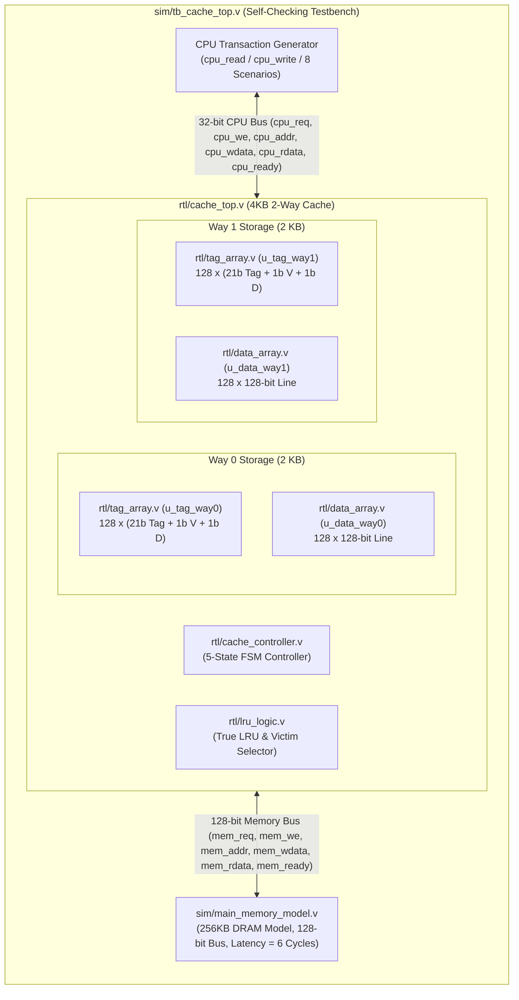

# Đồ Án Kiến Trúc Máy Tính: Thiết Kế Bộ Nhớ Đệm 4KB 2-Way Set-Associative Cache Controller (Verilog RTL)

Dự án này tập trung thiết kế, hiện thực hóa phần cứng ở mức **RTL (Register-Transfer Level)** bằng ngôn ngữ **Verilog HDL** và kiểm chứng toàn diện bộ điều khiển bộ nhớ đệm **4KB 2-Way Set-Associative Cache Controller** theo chuẩn kiến trúc bộ nhớ phân cấp trong giáo trình *Computer Organization and Design* (David A. Patterson & John L. Hennessy – Chương 5, Mục 5.3 – 5.4).

---

## Mục Lục

1. [Thông Số Kỹ Thuật Kiến Trúc (Architecture Specifications)](#1-thông-số-kỹ-thuật-kiến-trúc-architecture-specifications)
2. [Cấu Trúc Thư Mục Dự Án Tinh Gọn (Project Structure)](#2-cấu-trúc-thư-mục-dự-án-tinh-gọn-project-structure)
3. [Vai Trò Chi Tiết Của Các Khối Phần Cứng RTL](#3-vai-trò-chi-tiết-của-các-khối-phần-cứng-rtl)
4. [Môi Trường Mô Phỏng & Kiểm Thử](#4-môi-trường-mô-phỏng--kiểm-thử)
5. [Hướng Dẫn Biên Dịch & Chạy Mô Phỏng (Quick Start)](#5-hướng-dẫn-biên-dịch--chạy-mô-phỏng-quick-start)
6. [Tóm Tắt 8 Kịch Bản Kiểm Thử & Kết Quả Đo Lường](#6-tóm-tắt-8-kịch-bản-kiểm-thử--kết-quả-đo-lường)
7. [Tài Liệu Kỹ Thuật & Hướng Dẫn Vấn Đáp](#7-tài-liệu-kỹ-thuật--hướng-dẫn-vấn-đáp)

---

## 1. Thông Số Kỹ Thuật Kiến Trúc (Architecture Specifications)

| Thông số kỹ thuật | Giá trị thiết kế | Giải thích chi tiết |
| :--- | :--- | :--- |
| **Dung lượng dữ liệu (Cache Capacity)** | `4 KB` (`4,096 Bytes`) | Dung lượng dữ liệu thuần túy (không tính overhead của Tag/Cờ) |
| **Kích thước dòng (Line / Block Size)** | `16 Bytes` (`128 bits`) | Mỗi dòng chứa `4 Words` (mỗi Word `32 bits`) |
| **Độ kết hợp (Associativity)** | `2-Way Set-Associative` | Mỗi tập hợp (Set) gồm 2 đường (`Way 0` và `Way 1`) |
| **Tổng số dòng (Total Lines)** | `256 Lines` | $4096 \text{ Bytes} / 16 \text{ Bytes} = 256 \text{ Lines}$ |
| **Tổng số tập hợp (Number of Sets)** | `128 Sets` | $256 \text{ Lines} / 2 \text{ Ways} = 128 \text{ Sets}$ (`Set 0` $\to$ `Set 127`) |
| **Phân hoạch địa chỉ 32-bit** | `[31:11]` Tag (21b) \| `[10:4]` Index (7b) \| `[3:2]` Word (2b) \| `[1:0]` Byte (2b) | $2^7 = 128\text{ Sets}$, $2^2 = 4\text{ Words}$, $2^2 = 4\text{ Bytes}$ |
| **Chính sách Ghi Hit** | **Write-Back** | Cập nhật vào Cache, đánh dấu `Dirty = 1`, chỉ trả về DRAM khi bị trục xuất |
| **Chính sách Ghi Miss** | **Write-Allocate** | Nạp dòng 128-bit từ DRAM, trộn từ 32-bit mới vào và bật `Dirty = 1` |
| **Thuật toán Thay thế** | **True LRU (1-bit/Set)** | Cây ưu tiên: Nạp vào Way trống trước, nếu đầy mới trục xuất theo bit LRU |
| **Độ trễ Truy cập (Latency)** | Hit: `1 chu kỳ` | Clean Miss: `10 chu kỳ` \| Dirty Miss: `18 chu kỳ` (DRAM Latency = 6 chu kỳ) |
| **Tổng ngân sách bit SRAM** | **38,784 bits** | Gồm: 32,768b Data + 5,376b Tag + 256b Valid + 256b Dirty + 128b LRU |

---

## 2. Cấu Trúc Thư Mục Dự Án Tinh Gọn (Project Structure)

Dự án đã được tinh giản tối đa, chỉ giữ lại các thành phần cốt lõi của bộ điều khiển Cache và môi trường kiểm thử Verilog:

```text
project_KTMT/
├── rtl/                                      # [1] Toàn bộ mã nguồn phần cứng Verilog RTL (Synthesizable)
│   ├── cache_defines.vh                      # File Header: Định nghĩa tham số bit, trường địa chỉ & mã hóa FSM
│   ├── cache_top.v                           # Module Đỉnh (Top-Level): Ghép nối Controller, Mảng SRAM & LRU
│   ├── cache_controller.v                    # Bộ điều khiển trung tâm: Máy trạng thái FSM 5 bước
│   ├── tag_array.v                           # Mảng lưu Tag (21b), Valid (1b), Dirty (1b) cho từng Way
│   ├── data_array.v                          # Mảng lưu Dữ liệu (128 dòng x 128b) hỗ trợ ghi Word và Line
│   └── lru_logic.v                           # Khối logic quản lý bit LRU và chọn đường nạn nhân (Victim)
│
├── sim/                                      # [2] Môi trường mô phỏng & Kiểm thử tự động (Verification)
│   ├── main_memory_model.v                   # Mô hình DRAM hành vi (256KB, bus 128-bit, trễ 6 chu kỳ)
│   └── tb_cache_top.v                        # Testbench tự động kiểm tra 8 kịch bản (Self-Checking)
│
├── scripts/                                  # [3] Script tự động hóa biên dịch & mô phỏng
│   └── run_sim.bat                           # Script Windows Batch chạy nhanh 1-click
│
├── docs/                                     # [4] Hệ thống tài liệu kỹ thuật chuyên sâu bằng tiếng Việt
│   ├── 01_Co_So_Ly_Thuyet_Bo_Nho_Dem_Cache.md
│   ├── 02_Thiet_Ke_Vi_Kien_Truc_RTL_va_FSM.md
│   └── 03_Kiem_Thu_Phan_Tich_Ket_Qua_va_Cau_Hoi_Bao_Ve.md
│
└── README.md                                 # Hướng dẫn tổng quan dự án (file này)
```

### Sơ Đồ Khối Phân Cấp Phần Cứng & Kiểm Thử



---

## 3. Vai Trò Chi Tiết Của Các Khối Phần Cứng RTL

Tất cả các file trong [`rtl/`](file:///b:/KTMT/project_KTMT/rtl) đều đạt chuẩn **Synthesizable Verilog**:

| File RTL | Chức năng chính |
| :--- | :--- |
| [`cache_defines.vh`](file:///b:/KTMT/project_KTMT/rtl/cache_defines.vh) | **Header tham số hóa toàn cục**: Định nghĩa độ rộng bus, vị trí các trường bit địa chỉ và mã hóa trạng thái FSM (`STATE_IDLE` đến `STATE_REFILL_UPDATE`). |
| [`cache_top.v`](file:///b:/KTMT/project_KTMT/rtl/cache_top.v) | **Module Đỉnh (Top-Level)**: Kết nối giao diện CPU và DRAM; khởi tạo 2 khối Tag Array, 2 khối Data Array, khối LRU và Controller; thực hiện so sánh Tag song song 2 Way (`hit0`, `hit1`) và bộ chọn kênh đọc dữ liệu. |
| [`cache_controller.v`](file:///b:/KTMT/project_KTMT/rtl/cache_controller.v) | **Bộ điều khiển trung tâm (FSM 5 bước)**: Điều khiển toàn bộ tín hiệu ghi SRAM, bắt tay DRAM, thực hiện chính sách Write-Back và Write-Allocate (mạch trộn từ 32-bit `merged_line`), xử lý chống lỗi giao dịch ảo trên bus DRAM. |
| [`tag_array.v`](file:///b:/KTMT/project_KTMT/rtl/tag_array.v) | **Mảng Tag và Cờ trạng thái (1 Way)**: Gồm $128 \times (21\text{b Tag} + 1\text{b Valid} + 1\text{b Dirty})$. Đọc tổ hợp không trễ để so sánh Tag trong 1 chu kỳ; ghi đồng bộ theo sườn lên clock. |
| [`data_array.v`](file:///b:/KTMT/project_KTMT/rtl/data_array.v) | **Mảng Dữ liệu (1 Way - 2KB)**: Gồm $128 \times 128\text{-bit}$. Hỗ trợ ghi chọn lọc 32-bit theo Word Index khi Write Hit và ghi cả dòng 128-bit khi nạp khối từ DRAM. |
| [`lru_logic.v`](file:///b:/KTMT/project_KTMT/rtl/lru_logic.v) | **Khối quản lý True LRU**: Mảng 128 bits theo dõi đường ít dùng gần đây nhất; mạch chọn Victim theo cây ưu tiên 3 mức (ưu tiên Way trống trước). |

---

## 4. Môi Trường Mô Phỏng & Kiểm Thử

| File Kiểm Thử | Chức năng chính |
| :--- | :--- |
| [`main_memory_model.v`](file:///b:/KTMT/project_KTMT/sim/main_memory_model.v) | **Mô hình DRAM hành vi**: Bộ nhớ 256KB giao tiếp bus 128-bit. Độ trễ có thể cấu hình (`LATENCY_CYCLES = 6`). Nạp sẵn giá trị có quy luật `0x1000_0000 | Addr` giúp dễ dàng kiểm tra tính toàn vẹn dữ liệu. |
| [`tb_cache_top.v`](file:///b:/KTMT/project_KTMT/sim/tb_cache_top.v) | **Self-Checking Testbench**: Tạo xung nhịp 100MHz (10ns), phát các giao dịch `cpu_read`/`cpu_write`, tự động đếm chu kỳ Stall, so sánh dữ liệu đọc về với giá trị kỳ vọng và xuất file dạng sóng [`cache_sim.vcd`](file:///b:/KTMT/project_KTMT/cache_sim.vcd). |

---

## 5. Hướng Dẫn Biên Dịch & Chạy Mô Phỏng (Quick Start)

### Yêu Cầu Công Cụ
- **Icarus Verilog (`iverilog`, `vvp`)**: Dùng để biên dịch và chạy mô phỏng Verilog.
- **GTKWave** *(tùy chọn)*: Dùng để quan sát dạng sóng xung nhịp và chuyển đổi trạng thái FSM.

### Cách Chạy Nhanh

#### Cách 1: Dùng file Batch (Khuyến nghị trên Windows)
Nhấp đúp vào file `scripts\run_sim.bat` trong thư mục hoặc chạy từ Terminal:
```cmd
.\scripts\run_sim.bat
```

#### Cách 2: Biên dịch thủ công bằng lệnh `iverilog`
```bash
iverilog -I rtl -o sim/cache_sim.out rtl/cache_top.v rtl/cache_controller.v rtl/tag_array.v rtl/data_array.v rtl/lru_logic.v sim/main_memory_model.v sim/tb_cache_top.v
vvp sim/cache_sim.out
```

---

## 6. Tóm Tắt 8 Kịch Bản Kiểm Thử & Kết Quả Đo Lường

Testbench [`tb_cache_top.v`](file:///b:/KTMT/project_KTMT/sim/tb_cache_top.v) tự động thực thi 8 kịch bản kiểm tra toàn diện:

1. **Scenario 1 – Cold Miss (Compulsory Miss)**: Đọc khởi tạo `0x0000_1000` $\to$ Miss, nạp từ DRAM vào Way 0 tốn đúng **10 chu kỳ** (`cpu_ready = 1`).
2. **Scenario 2 – Read Hit & Spatial Locality**: Đọc lại `0x1000` và 3 từ kế cận `0x1004, 0x1008, 0x100C` $\to$ Cả 4 lần đều **Hit trong đúng 1 chu kỳ**.
3. **Scenario 3 – Write Hit (Write-Back Policy)**: Ghi `0xCAFE_BABE` vào `0x1000` $\to$ Hit trong **1 chu kỳ**, đánh dấu `Dirty = 1`, DRAM vẫn giữ nguyên giá trị cũ.
4. **Scenario 4 – Write Miss (Write-Allocate Policy)**: Ghi `0xDEAD_BEEF` vào `0x2000` $\to$ Cấp phát vào Way 1 đang trống, nạp dòng từ DRAM, trộn từ mới và bật `Dirty = 1` trong **10 chu kỳ**.
5. **Scenario 5 – Conflict Miss, LRU Eviction & Dirty Write-Back**: Cả 2 Way của `Set 0` đều bẩn. Khi truy cập `0x3000` và đọc lại `0x1000` $\to$ Trục xuất đúng đường LRU, ghi trả dữ liệu bẩn về DRAM rồi nạp dòng mới trong đúng **18 chu kỳ/lần**.
6. **Scenario 6 – Clean Victim Eviction**: Truy cập `0x4000` trục xuất dòng sạch `0x3000` $\to$ Bỏ qua bước Write-Back, hoàn thành trong **10 chu kỳ**.
7. **Scenario 7 – Textbook Section 5.4 Benchmark**: Chuỗi truy cập đan xen `A -> B -> A -> C -> B` trên `Set 10` chứng minh kiến trúc 2-Way LRU loại bỏ triệt để hiện tượng xung đột luân phiên (Ping-pong conflict) của Direct-Mapped.
8. **Scenario 8 – Multi-Set Boundary & AMAT**: Kiểm tra giải mã độc lập ở `Set 63` và `Set 127`, tính toán các chỉ số định lượng.

### Kết Quả Đo Lường Hiệu Năng
```text
================================================================================
             QUANTITATIVE ARCHITECTURAL PERFORMANCE SUMMARY                     
================================================================================
  Total Memory Accesses       : 26 (24 Read, 2 Write)
  Cache Hits                  : 15 (Hit Rate: 57.69 %)
  Cache Misses                : 11 (Miss Rate: 42.31 %)
    - Clean Misses            : 9  (10 cycles/miss)
    - Dirty Write-Back Misses : 2  (18 cycles/miss)
  Total Access Cycles         : 141 cycles (Stall Cycles: 115)
  Measured AMAT               : 5.42 cycles (54.23 ns @ 100MHz)
  Verification Errors         : 0
================================================================================
  >>> [TESTBENCH RESULT: ALL 8 SCENARIOS PASSED SUCCESSFULLY!] <<<
================================================================================
```

---

## 7. Tài Liệu Kỹ Thuật & Hướng Dẫn Vấn Đáp

Các tài liệu giải thích chi tiết trong thư mục [`docs/`](file:///b:/KTMT/project_KTMT/docs):
- [**01_Co_So_Ly_Thuyet_Bo_Nho_Dem_Cache.md**](file:///b:/KTMT/project_KTMT/docs/01_Co_So_Ly_Thuyet_Bo_Nho_Dem_Cache.md): Cơ sở lý thuyết về tổ chức bộ nhớ đệm, ánh xạ địa chỉ, công thức tính dung lượng, chính sách ghi và thời gian truy cập trung bình (AMAT).
- [**02_Thiet_Ke_Vi_Kien_Truc_RTL_va_FSM.md**](file:///b:/KTMT/project_KTMT/docs/02_Thiet_Ke_Vi_Kien_Truc_RTL_va_FSM.md): Sơ đồ khối Datapath, sơ đồ máy trạng thái FSM 5 trạng thái, phân tích định thời từng chu kỳ và kỹ thuật xử lý bắt tay DRAM.
- [**03_Kiem_Thu_Phan_Tich_Ket_Qua_va_Cau_Hoi_Bao_Ve.md**](file:///b:/KTMT/project_KTMT/docs/03_Kiem_Thu_Phan_Tich_Ket_Qua_va_Cau_Hoi_Bao_Ve.md): Chi tiết 8 kịch bản kiểm thử, mốc thời gian quan sát trên GTKWave và ngân hàng 12 câu hỏi vấn đáp chuyên sâu khi bảo vệ đồ án.
