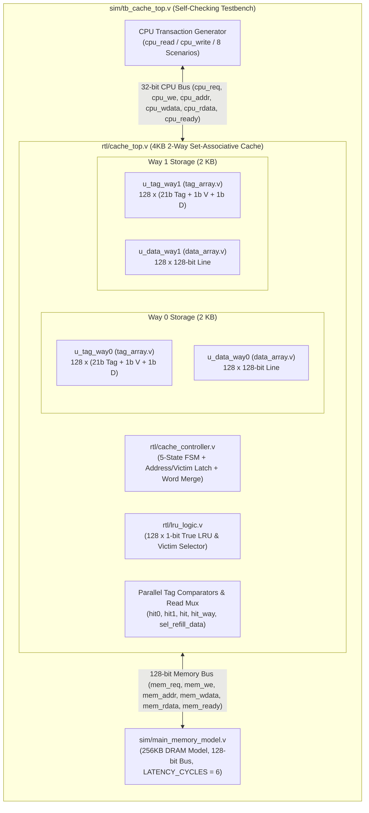

# Đồ Án Môn Học Kiến Trúc Máy Tính: Thiết Kế Bộ Điều Khiển Bộ Nhớ Đệm 4KB 2-Way Set-Associative Cache (Verilog RTL)

> **Môn học:** Kiến trúc Máy tính (Computer Architecture)  
> **Đề tài:** Mô phỏng cache sử dụng Verilog — Thiết kế, hiện thực hóa mức RTL và kiểm chứng bộ điều khiển **4KB 2-Way Set-Associative Cache Controller** (Write-Back, Write-Allocate, True LRU)  
> **Giáo trình tham khảo:** *Computer Organization and Design: The Hardware/Software Interface* (David A. Patterson & John L. Hennessy)

| Thông tin đồ án | Chi tiết |
| :--- | :--- |
| **Tên đề tài** | Mô phỏng cache sử dụng Verilog (4KB 2-Way Set-Associative Cache Controller) |
| **Môn học** | Kiến trúc Máy tính (KTMT) |
| **Giảng viên hướng dẫn** | PGS. TS. Nguyễn Đình Hân |
| **Nhóm thực hiện** | Nhóm 3 |
| **Ngôn ngữ & Công cụ** | Verilog HDL (IEEE 1364-2001), Icarus Verilog (`iverilog`, `vvp`), GTKWave |

### Thành Viên Nhóm 3

| STT | MSSV | Họ và tên |
| :---: | :---: | :--- |
| 1 | `202419012` | HOÀNG VŨ TÙNG |
| 2 | `202418956` | NGUYỄN THIỆN NHÂN |
| 3 | `202418964` | NGÔ TRƯỜNG PHÚC |
| 4 | `202418868` | LÂM QUÝ ĐÔ |

---

## Mục Lục

1. [Giới Thiệu & Mục Tiêu Đề Tài](#1-giới-thiệu--mục-tiêu-đề-tài)
2. [Thông Số Kỹ Thuật Kiến Trúc](#2-thông-số-kỹ-thuật-kiến-trúc)
3. [Cấu Trúc Thư Mục Dự Án](#3-cấu-trúc-thư-mục-dự-án)
4. [Thiết Kế Vi Kiến Trúc Phần Cứng (RTL)](#4-thiết-kế-vi-kiến-trúc-phần-cứng-rtl)
5. [Phân Tích Giao Thức & Định Thời Từng Chu Kỳ](#5-phân-tích-giao-thức--định-thời-từng-chu-kỳ)
6. [Hướng Dẫn Cài Đặt & Chạy Mô Phỏng](#6-hướng-dẫn-cài-đặt--chạy-mô-phỏng)
7. [Kịch Bản Kiểm Thử & Kết Quả Thực Nghiệm](#7-kịch-bản-kiểm-thử--kết-quả-thực-nghiệm)
8. [Hệ Thống Tài Liệu Kỹ Thuật](#8-hệ-thống-tài-liệu-kỹ-thuật)
9. [Giả Định Thiết Kế, Hạn Chế & Hướng Phát Triển](#9-giả-định-thiết-kế-hạn-chế--hướng-phát-triển)
10. [Tài Liệu Tham Khảo](#10-tài-liệu-tham-khảo)

---

## 1. Giới Thiệu & Mục Tiêu Đề Tài

### 1.1. Đặt vấn đề
Trong hệ thống máy tính hiện đại, tốc độ xử lý của CPU vượt xa tốc độ truy cập bộ nhớ chính DRAM (*Memory Wall*). Nếu mọi lệnh đọc/ghi dữ liệu (`Load`/`Store`) đều truy cập trực tiếp xuống DRAM, CPU sẽ tiêu tốn phần lớn thời gian ở trạng thái chờ (*Memory Stall*). Bộ nhớ đệm (**Cache**) sử dụng SRAM tốc độ cao nằm giữa CPU và DRAM nhằm khai thác **nguyên lý cục bộ về thời gian (*Temporal Locality*)** và **không gian (*Spatial Locality*)**, từ đó giảm đáng kể thời gian truy cập bộ nhớ trung bình (**AMAT**).

### 1.2. Mục tiêu đồ án
- Phân tích và mô hình hóa kiến trúc **2-Way Set-Associative Cache** dung lượng dữ liệu **4 KB** theo giáo trình *Computer Organization and Design: The Hardware/Software Interface*.
- Hiện thực hóa đầy đủ các khối phần cứng mức **RTL (Register-Transfer Level)** bằng Verilog HDL có khả năng tổng hợp (*Synthesizable RTL* trong `rtl/`): Datapath, SRAM Tag/Data Array, bộ thay thế **True LRU**, và **FSM 5 trạng thái**.
- Áp dụng đầy đủ chính sách ghi **Write-Back** kết hợp **Write-Allocate** (Word Merging), giải quyết bài toán đồng nhất dữ liệu và giao thức bắt tay bus bộ nhớ không lỗi giao dịch ảo.
- Xây dựng môi trường kiểm thử tự động (**Self-Checking Testbench**) với mô hình DRAM hành vi có độ trễ cấu hình được, kiểm chứng 8 kịch bản trọng tâm và định lượng hiệu năng (**Hit Rate**, **Stall Cycles**, **AMAT**).

---

## 2. Thông Số Kỹ Thuật Kiến Trúc

| Thông số kiến trúc | Giá trị thiết kế | Phân tích & Diễn giải |
| :--- | :--- | :--- |
| **Dung lượng dữ liệu (Cache Capacity)** | `4 KB` (`4,096 Bytes`) | $32,768\text{ bits}$ dữ liệu thuần túy (không tính metadata) |
| **Kích thước dòng (Line / Block Size)** | `16 Bytes` (`128 bits`) | Mỗi dòng gồm `4 Words`, mỗi Word rộng `32 bits` (`4 Bytes`) |
| **Độ kết hợp (Associativity)** | `2-Way Set-Associative` | Mỗi tập hợp (Set) gồm `2 Ways` (`Way 0` và `Way 1`) |
| **Tổng số dòng (Total Lines)** | `256 Lines` | $4096\text{ Bytes} / 16\text{ Bytes} = 256\text{ Lines}$ (`128 Lines/Way`) |
| **Tổng số tập hợp (Number of Sets)** | `128 Sets` | $256\text{ Lines} / 2\text{ Ways} = 128\text{ Sets}$ (`Set 0` $\to$ `Set 127`) |
| **Không gian địa chỉ CPU** | `32-bit` (`cpu_addr[31:0]`) | Giao tiếp bus dữ liệu CPU `32-bit` (word-aligned) |
| **Bus bộ nhớ chính DRAM** | `128-bit` (`mem_rdata`, `mem_wdata`) | Truyền song song cả dòng `16 Bytes`, địa chỉ căn chỉnh 16-byte |
| **Chính sách Ghi Hit (Write Hit)** | **Write-Back** | Ghi trực tiếp vào Cache, bật `Dirty = 1`, chỉ ghi trả DRAM khi bị trục xuất |
| **Chính sách Ghi Miss (Write Miss)** | **Write-Allocate** | Đọc dòng 128-bit từ DRAM, trộn Word 32-bit mới (`merged_line`), bật `Dirty = 1` |
| **Thuật toán Thay thế** | **True LRU (1-bit/Set)** | Ưu tiên cấp phát vào Way trống (`Valid = 0`) trước; khi đầy mới trục xuất theo bit LRU |
| **Độ trễ truy cập (với DRAM Latency = 6)** | Hit: `1 chu kỳ` | Clean Miss: `10 chu kỳ` (`9` stall) \| Dirty Miss: `18 chu kỳ` (`17` stall) |
| **Tổng ngân sách bit SRAM vật lý** | **38,784 bits** ($\approx 4.73\text{ KiB}$) | `32,768b` Data + `5,376b` Tag + `256b` Valid + `256b` Dirty + `128b` LRU |

### Phân hoạch Địa chỉ 32-bit (`cpu_addr[31:0]`)

```text
 31                         11 10           4 3        2 1        0
+-----------------------------+--------------+----------+----------+
|         Tag (21 bits)       | Index (7 bit)| Word(2b) | Byte(2b) |
+-----------------------------+--------------+----------+----------+
 \_____________  ____________/ \_____  _____/ \___  ___/ \___  ___/
               \/                    \/           \/         \/
       So sánh song song       Chọn 1 trong    Chọn 1/4   Offset Byte
       với Way 0 & Way 1         128 Sets       Words     (Word-aligned)
```

---

## 3. Cấu Trúc Thư Mục Dự Án

```text
project_KTMT/
├── rtl/                                      # Mã nguồn phần cứng Verilog RTL (Synthesizable)
│   ├── cache_defines.vh                      # Header: tham số kiến trúc, phân bit địa chỉ & mã hóa FSM
│   ├── cache_top.v                           # Top-Level: kết nối CPU/DRAM, so sánh Tag song song & Read Mux
│   ├── cache_controller.v                    # Bộ điều khiển trung tâm: FSM 5 trạng thái & mạch Write-Allocate
│   ├── tag_array.v                           # Mảng lưu 128 x (21b Tag + 1b Valid + 1b Dirty) cho 1 Way
│   ├── data_array.v                          # Mảng lưu 128 x 128-bit Data (ghi theo Line 128b hoặc Word 32b)
│   └── lru_logic.v                           # Mảng 128-bit True LRU & logic chọn Victim Way 3 mức ưu tiên
│
├── sim/                                      # Môi trường mô phỏng & Kiểm thử tự động
│   ├── main_memory_model.v                   # Mô hình DRAM hành vi (256 KB, bus 128-bit, Latency = 6 chu kỳ)
│   └── tb_cache_top.v                        # Self-Checking Testbench kiểm chứng 8 kịch bản & tính AMAT
│
├── scripts/                                  # Script tự động hóa biên dịch & mô phỏng
│   └── run_sim.bat                           # Script Windows Batch chạy nhanh (iverilog + vvp)
│
├── docs/                                     # Hệ thống tài liệu lý thuyết, thiết kế RTL và kiểm thử
│   ├── 01_Co_So_Ly_Thuyet_Bo_Nho_Dem_Cache.md
│   ├── 02_Thiet_Ke_Vi_Kien_Truc_RTL_va_FSM.md
│   └── 03_Kiem_Thu_va_Phan_Tich_Ket_Qua.md
│
├── .gitignore                                # Loại trừ file biên dịch/sóng tạm (*.out, *.vcd, *.log)
└── README.md                                 # Tài liệu tổng quan dự án (file này)
```

---

## 4. Thiết Kế Vi Kiến Trúc Phần Cứng (RTL)

### 4.1. Sơ đồ Khối Hệ thống (`cache_top.v`)



### 4.2. Đặc tả Giao diện Tín hiệu Module Đỉnh (`cache_top`)

| Nhóm tín hiệu | Tên cổng | Hướng | Độ rộng | Mô tả chức năng |
| :--- | :--- | :---: | :---: | :--- |
| **Hệ thống** | `clk` | `input` | 1 | Xung nhịp hệ thống (Testbench dùng `100 MHz`, chu kỳ `10 ns`) |
| | `rst_n` | `input` | 1 | Reset bất đồng bộ tích cực mức thấp (`0`: xóa `Valid`, `Dirty`, `LRU`, đưa FSM về `IDLE`) |
| **Giao diện CPU** | `cpu_req` | `input` | 1 | Yêu cầu truy cập bộ nhớ từ CPU (`1`: có yêu cầu) |
| | `cpu_we` | `input` | 1 | Loại truy cập (`0`: Đọc / Load, `1`: Ghi / Store) |
| | `cpu_addr` | `input` | 32 | Địa chỉ byte 32-bit từ CPU |
| | `cpu_wdata` | `input` | 32 | Dữ liệu 32-bit CPU cần ghi khi `cpu_we = 1` |
| | `cpu_rdata` | `output` | 32 | Dữ liệu 32-bit trả về cho CPU khi đọc xong |
| | `cpu_ready` | `output` | 1 | Báo hoàn tất giao dịch (`1`: xong, `0`: CPU phải Stall chờ) |
| **Giao diện DRAM** | `mem_req` | `output` | 1 | Yêu cầu giao dịch xuống DRAM (`~mem_ready` trong `WRITE_BACK` / `FETCH_MEM`) |
| | `mem_we` | `output` | 1 | Loại giao dịch DRAM (`0`: Đọc dòng 128-bit, `1`: Ghi trả dòng bẩn 128-bit) |
| | `mem_addr` | `output` | 32 | Địa chỉ khối căn chỉnh 16-byte (`[3:0] = 4'b0000`) gửi xuống DRAM |
| | `mem_wdata` | `output` | 128 | Khối dữ liệu 128-bit ghi trả DRAM khi Write-Back |
| | `mem_rdata` | `input` | 128 | Khối dữ liệu 128-bit nạp từ DRAM về Cache |
| | `mem_ready` | `input` | 1 | Xung 1 chu kỳ từ DRAM báo hoàn tất giao dịch |
| **Giám sát (Debug)** | `hit_out` | `output` | 1 | Nhấp nháy `1` tại `STATE_COMPARE_TAG` khi xảy ra Cache Hit |
| | `miss_out` | `output` | 1 | Nhấp nháy `1` tại `STATE_COMPARE_TAG` khi xảy ra Cache Miss |
| | `state_out` | `output` | 3 | Trạng thái hiện tại của FSM (`0` đến `4`) |

### 4.3. Chi tiết các Module RTL

| File | Vai trò & Cơ chế thiết kế chính |
| :--- | :--- |
| [`rtl/cache_defines.vh`](rtl/cache_defines.vh) | Tham số hóa độ rộng bus (`ADDR_WIDTH=32`, `DATA_WIDTH=32`, `LINE_WIDTH=128`, `NUM_SETS=128`), phân tách trường bit địa chỉ và mã hóa 5 trạng thái FSM. |
| [`rtl/cache_top.v`](rtl/cache_top.v) | Khởi tạo `u_tag_way0/1`, `u_data_way0/1`, `u_lru_logic`, `u_controller`; bảo vệ chỉ số truy cập SRAM (`current_index`, `current_word_idx`) bằng `latched_addr` khi đang xử lý Miss; so sánh Tag song song (`hit0`, `hit1`); tích hợp đường bypass `sel_refill_data` xuất `refill_rdata` trực tiếp ra `cpu_rdata` ngay chu kỳ `STATE_REFILL_UPDATE`. |
| [`rtl/cache_controller.v`](rtl/cache_controller.v) | Điều khiển FSM 5 trạng thái; chốt yêu cầu CPU (`latched_addr`, `latched_wdata`, `latched_we`) và thông tin nạn nhân (`latched_victim_way`, `latched_victim_tag`, `latched_victim_data`); trộn từ 32-bit vào dòng 128-bit qua mạch `merged_line` cho Write-Allocate; triệt tiêu lỗi giao dịch ảo bằng `mem_req = ~mem_ready`. |
| [`rtl/tag_array.v`](rtl/tag_array.v) | Lưu trữ 128 mục `(Tag 21b + Valid 1b + Dirty 1b)`. Đọc tổ hợp để kiểm tra Hit/Miss trong 1 chu kỳ; ghi đồng bộ theo sườn lên `clk` (nạp Tag tự động bật `Valid <= 1`). |
| [`rtl/data_array.v`](rtl/data_array.v) | Lưu trữ 128 dòng $\times$ 128-bit (`2 KB/Way`). Hỗ trợ ghi toàn dòng `line_we` khi Refill và ghi chọn lọc 1 Word 32-bit `word_we` theo `word_idx` khi Write Hit; đọc tổ hợp `line_out` và `word_out`. |
| [`rtl/lru_logic.v`](rtl/lru_logic.v) | Lưu mảng `lru_mem[0:127]`. Khi cần chọn nạn nhân: ưu tiên `Way 0` nếu `!valid0`, tiếp theo `Way 1` nếu `!valid1`, chỉ dùng `lru_bit` khi cả 2 Way đã hợp lệ. Cập nhật `lru_mem[index] <= ~access_way` khi Hit hoặc Refill xong. |

### 4.4. Máy Trạng Thái Hữu Hạn 5 Trạng Thái (`cache_controller.v`)

```mermaid
stateDiagram-v2
    [*] --> STATE_IDLE : Reset (rst_n = 0)
    STATE_IDLE --> STATE_IDLE : cpu_req = 0
    STATE_IDLE --> STATE_COMPARE_TAG : cpu_req = 1\n(Chốt cpu_addr, cpu_wdata, cpu_we)

    STATE_COMPARE_TAG --> STATE_IDLE : hit = 1\n(cpu_ready = 1, cập nhật LRU;\nnếu Write Hit: ghi Word & Dirty = 1)
    STATE_COMPARE_TAG --> STATE_FETCH_MEM : hit = 0 && victim_dirty = 0\n(Clean Miss: bỏ qua Write-Back)
    STATE_COMPARE_TAG --> STATE_WRITE_BACK : hit = 0 && victim_dirty = 1\n(Dirty Miss: chốt Tag & Line nạn nhân)

    STATE_WRITE_BACK --> STATE_WRITE_BACK : mem_ready = 0\n(mem_req = 1, mem_we = 1)
    STATE_WRITE_BACK --> STATE_FETCH_MEM : mem_ready = 1\n(Đã ghi trả 128-bit về DRAM)

    STATE_FETCH_MEM --> STATE_FETCH_MEM : mem_ready = 0\n(mem_req = 1, mem_we = 0)
    STATE_FETCH_MEM --> STATE_REFILL_UPDATE : mem_ready = 1\n(Chốt latched_mem_rdata)

    STATE_REFILL_UPDATE --> STATE_IDLE : Hoàn tất nạp Cache\n(Ghi Line/Merged Line + Tag + Valid + Dirty,\ncập nhật LRU, cpu_ready = 1)
```



---

## 5. Phân Tích Giao Thức & Định Thời Từng Chu Kỳ

Với mô hình DRAM trong [`sim/main_memory_model.v`](sim/main_memory_model.v) cấu hình `LATENCY_CYCLES = 6`, mỗi pha truy cập DRAM (`STATE_WRITE_BACK` hoặc `STATE_FETCH_MEM`) tiêu tốn đúng **8 chu kỳ** (1 chu kỳ nhận `mem_req`, 5 chu kỳ đếm trễ `2..6`, 1 chu kỳ phát `mem_ready`, 1 chu kỳ FSM chuyển trạng thái).

| Loại truy cập | Đường đi FSM | Phân bổ chu kỳ | Tổng độ trễ (CPU) |
| :--- | :--- | :--- | :---: |
| **Read / Write Hit** | `IDLE` $\to$ `COMPARE_TAG` $\to$ `IDLE` | `COMPARE_TAG` (`1`) | **1 chu kỳ** (`0` stall) |
| **Clean Miss** *(Cold Miss / Clean Conflict / Clean Write-Allocate)* | `IDLE` $\to$ `COMPARE_TAG` $\to$ `FETCH_MEM` $\to$ `REFILL_UPDATE` $\to$ `IDLE` | `COMPARE_TAG` (`1`) + `FETCH_MEM` (`8`) + `REFILL_UPDATE` (`1`) | **10 chu kỳ** (`9` stall) |
| **Dirty Miss** *(Trục xuất nạn nhân có `Valid = 1 && Dirty = 1`)* | `IDLE` $\to$ `COMPARE_TAG` $\to$ `WRITE_BACK` $\to$ `FETCH_MEM` $\to$ `REFILL_UPDATE` $\to$ `IDLE` | `COMPARE_TAG` (`1`) + `WRITE_BACK` (`8`) + `FETCH_MEM` (`8`) + `REFILL_UPDATE` (`1`) | **18 chu kỳ** (`17` stall) |

> **Cơ chế chống giao dịch ảo (*Phantom Transaction Prevention*):** Tại `STATE_WRITE_BACK` và `STATE_FETCH_MEM`, `cache_controller.v` xuất `mem_req = ~mem_ready` và `main_memory_model.v` kiểm tra điều kiện `if (mem_req && !mem_ready)`. Nhờ vậy, khi DRAM vừa hoàn thành một giao dịch và bật `mem_ready = 1` ở chu kỳ chuyển tiếp trạng thái, DRAM không bị kích hoạt nhầm thêm một chu kỳ truy cập ảo nào.

---

## 6. Hướng Dẫn Cài Đặt & Chạy Mô Phỏng

### 6.1. Yêu cầu công cụ
- **Icarus Verilog** (`iverilog` và `vvp`): Biên dịch và chạy mô phỏng Verilog HDL.
- **GTKWave** *(tùy chọn)*: Mở file dạng sóng `cache_sim.vcd` để kiểm tra tín hiệu theo từng chu kỳ clock.

### 6.2. Chạy nhanh trên Windows (Khuyến nghị)
Chạy script [`scripts/run_sim.bat`](scripts/run_sim.bat) từ thư mục gốc dự án (tự động tìm `iverilog` trong `PATH` hoặc `C:\iverilog\bin`):
```cmd
.\scripts\run_sim.bat
```

### 6.3. Biên dịch và chạy thủ công (Windows / Linux / macOS)
```bash
iverilog -I rtl -o sim/cache_sim.out rtl/cache_top.v rtl/cache_controller.v rtl/tag_array.v rtl/data_array.v rtl/lru_logic.v sim/main_memory_model.v sim/tb_cache_top.v
vvp sim/cache_sim.out
```

### 6.4. Quan sát dạng sóng trên GTKWave
Sau khi chạy `vvp`, file `cache_sim.vcd` được sinh ra ở thư mục gốc. Mở bằng GTKWave:
```bash
gtkwave cache_sim.vcd
```
Các nhóm tín hiệu khuyến nghị thêm vào màn hình quan sát (trong `tb_cache_top.u_dut`):
- **Giao diện CPU:** `clk`, `rst_n`, `cpu_req`, `cpu_we`, `cpu_addr[31:0]`, `cpu_wdata[31:0]`, `cpu_rdata[31:0]`, `cpu_ready`
- **FSM & Hit/Miss/LRU:** `state_out[2:0]`, `hit_out`, `miss_out`, `hit0`, `hit1`, `victim_way`, `lru_bit`
- **Mảng Tag/Cờ:** `valid0`, `dirty0`, `tag0[20:0]`, `valid1`, `dirty1`, `tag1[20:0]`
- **Giao diện DRAM:** `mem_req`, `mem_we`, `mem_addr[31:0]`, `mem_wdata[127:0]`, `mem_rdata[127:0]`, `mem_ready`

---

## 7. Kịch Bản Kiểm Thử & Kết Quả Thực Nghiệm

Testbench [`sim/tb_cache_top.v`](sim/tb_cache_top.v) tạo xung nhịp **100 MHz (`10 ns`)**, kết nối DUT với [`sim/main_memory_model.v`](sim/main_memory_model.v) (khởi tạo dữ liệu nền `32'h1000_0000 | Addr`) và tự động kiểm tra **8 kịch bản**:

| Kịch bản | Mục tiêu kiểm chứng | Kết quả kỳ vọng & Đo được |
| :--- | :--- | :--- |
| **Scenario 1: Cold Miss** | Lỗi bắt buộc khi Cache vừa Reset (`Valid = 0`) tại `0x0000_1000`. | Miss, nạp vào `Set 0, Way 0` trong đúng **10 chu kỳ**. |
| **Scenario 2: Read Hit & Spatial Locality** | Đọc lại `0x1000` (Temporal) và 3 từ kế cận `0x1004, 0x1008, 0x100C` (Spatial). | Cả 4 truy cập đều **Hit trong 1 chu kỳ/lần**. |
| **Scenario 3: Write Hit (Write-Back)** | Ghi `0xCAFE_BABE` vào `0x0000_1000` đang nằm sẵn trong Cache. | Hit trong **1 chu kỳ**, `Dirty0 = 1`, DRAM vẫn giữ nguyên `0x1000_1000`. |
| **Scenario 4: Write Miss (Write-Allocate)** | Ghi `0xDEAD_BEEF` vào `0x0000_2000` (`Set 0`, `Way 1` còn trống). | Nạp vào `Way 1`, trộn word mới, giữ nguyên `0x2004 = 0x1000_2004`, `Dirty1 = 1` (**10 chu kỳ**). |
| **Scenario 5: Conflict Miss, LRU & Write-Back** | Truy cập `0x3000` rồi đọc lại `0x1000` khi `Set 0` đã đầy cả 2 Way đều bẩn. | Trục xuất đúng đường LRU, ghi trả `0xCAFE_BABE` và `0xDEAD_BEEF` về DRAM, mỗi lần **18 chu kỳ**. |
| **Scenario 6: Clean Victim Eviction** | Truy cập `0x4000` trục xuất nạn nhân sạch (`0x3000`, `Dirty = 0`). | Bỏ qua `STATE_WRITE_BACK`, hoàn thành trong **10 chu kỳ**. |
| **Scenario 7: Textbook Section 5.4 Benchmark** | Chuỗi `A (0x00A0) -> B (0x08A0) -> A -> C (0x10A0) -> B` trên `Set 10`. | Đạt **4 Miss, 1 Hit** (loại bỏ ping-pong conflict ở lần đọc `A` thứ 2 so với Direct-Mapped). |
| **Scenario 8: Multi-Set Boundary & AMAT** | Kiểm tra giải mã độc lập tại `Set 63 (0x03F0..0x03FC)` và `Set 127 (0x07F0..0x07FC)`. | Mỗi Set: `1 Cold Miss (10c) + 3 Spatial Hits (1c)`, không nhiễu chéo giữa các Set. |

### Kết quả thực thi mô phỏng thực tế (`vvp sim/cache_sim.out`)

```text
================================================================================
             QUANTITATIVE ARCHITECTURAL PERFORMANCE SUMMARY                     
================================================================================
  Total Memory Accesses       : 26
    - Read Accesses           : 24
    - Write Accesses          : 2
  Cache Hits                  : 15
  Cache Misses                : 11
    - Dirty Write-Backs (WB)  : 2
  Cache Hit Rate              : 57.69 %
  Cache Miss Rate             : 42.31 %
  Total Access Cycles         : 141 cycles
  Total Memory-Stall Cycles   : 115 cycles
  Measured AMAT               : 5.42 cycles (54.23 ns @ 100MHz)
  Verification Errors         : 0
================================================================================
  >>> [TESTBENCH RESULT: ALL 8 SCENARIOS PASSED SUCCESSFULLY!] <<<
================================================================================
```

> **Đối chiếu công thức AMAT:**  
> Tổng `141` chu kỳ trên `26` lần truy cập gồm `15` Hit (`15 × 1 = 15` chu kỳ), `9` Clean Miss (`9 × 10 = 90` chu kỳ) và `2` Dirty Write-Back Miss (`2 × 18 = 36` chu kỳ). Do đó $\text{AMAT} = 141 / 26 \approx 5.42\text{ chu kỳ}$ (`54.23 ns` ở `100 MHz`).

---

## 8. Hệ Thống Tài Liệu Kỹ Thuật

Thư mục [`docs/`](docs/) cung cấp bộ tài liệu lý thuyết và thiết kế chi tiết bám sát toàn bộ mã nguồn của đồ án:
1. [**01_Co_So_Ly_Thuyet_Bo_Nho_Dem_Cache.md**](docs/01_Co_So_Ly_Thuyet_Bo_Nho_Dem_Cache.md): Nguyên lý cục bộ, các phương pháp ánh xạ, giải mã địa chỉ 32-bit kèm ví dụ thực tế trong testbench, ngân sách bit SRAM (`38,784 bits`), chính sách ghi và công thức AMAT.
2. [**02_Thiet_Ke_Vi_Kien_Truc_RTL_va_FSM.md**](docs/02_Thiet_Ke_Vi_Kien_Truc_RTL_va_FSM.md): Chi tiết các module RTL, sơ đồ FSM 5 trạng thái, phân tích định thời từng chu kỳ và cơ chế bắt tay chống giao dịch ảo trên bus DRAM.
3. [**03_Kiem_Thu_va_Phan_Tich_Ket_Qua.md**](docs/03_Kiem_Thu_va_Phan_Tich_Ket_Qua.md): Diễn giải chi tiết trạng thái `Set`/`Way`/`Dirty`/`LRU` qua 8 kịch bản kiểm thử, phân rã số liệu hiệu năng và hướng dẫn xem dạng sóng trên GTKWave.

---

## 9. Giả Định Thiết Kế, Hạn Chế & Hướng Phát Triển

### Giả định & Hạn chế hiện tại
- **Truy cập căn chỉnh theo Word (`Word-Aligned`):** Giao diện CPU mặc định đọc/ghi đủ 32-bit (`[1:0]` Byte Offset chưa dùng để chọn byte lẻ; chưa có tín hiệu `byte_enable` / `cpu_strb[3:0]` cho lệnh `SB`/`SH`).
- **Không có bộ đệm ghi trả (*Write-Back Buffer*):** Khi xảy ra Dirty Conflict Miss, FSM phải chờ hoàn tất `STATE_WRITE_BACK` (8 chu kỳ) trước khi bắt đầu `STATE_FETCH_MEM`, làm độ trễ đạt `18 chu kỳ`.
- **Mô hình bộ nhớ mô phỏng:** `main_memory_model.v` là mô hình hành vi 256 KB phục vụ mô phỏng kiểm chứng chức năng (`mem_addr[17:4]`), chưa phải bộ điều khiển DRAM vật lý (AXI4 / SDRAM / DDR controller) để tổng hợp lên FPGA.

### Hướng phát triển mở rộng
1. Bổ sung **Write-Back / Victim Buffer** để đẩy dòng bẩn ra bộ đệm nền và thực hiện `FETCH_MEM` ngay lập tức, rút ngắn Dirty Miss từ `18 chu kỳ` xuống `10 chu kỳ`.
2. Hỗ trợ tín hiệu **Byte Enable (`cpu_be[3:0]`)** phục vụ ghi từng Byte / Half-word trong tập lệnh RISC-V hoặc MIPS.
3. Mở rộng độ kết hợp lên **4-Way Set-Associative** (thay thế bằng Pseudo-LRU cây nhị phân 3-bit/Set) và tích hợp trực tiếp vào hệ thống CPU Pipeline (L1 Data Cache / Instruction Cache).

---

## 10. Tài Liệu Tham Khảo

1. David A. Patterson, John L. Hennessy — *Computer Organization and Design: The Hardware/Software Interface*.
2. John L. Hennessy, David A. Patterson — *Computer Architecture: A Quantitative Approach*.
3. William Stallings — *Computer Organization and Architecture: Designing for Performance*.
4. Eben Upton, Jeffrey Duntemann, Ralph Roberts, Tim Mamtora, Ben Everard — *Learning Computer Architecture with the Raspberry Pi*.
5. Tài liệu chuyên đề nội bộ trong thư mục [`docs/`](docs/).
