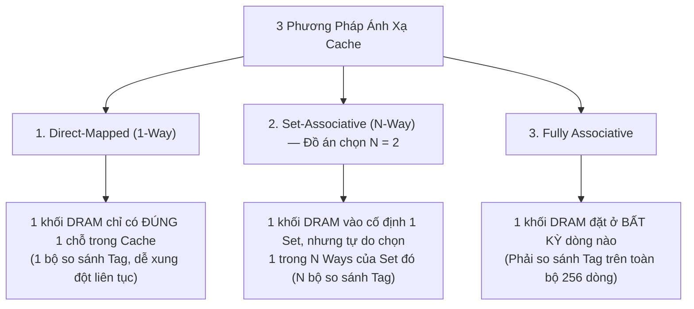

# Tài Liệu 01: Cơ Sở Lý Thuyết Bộ Nhớ Đệm (Cache) & Ánh Xạ Vào Thiết Kế Đồ Án

Tài liệu này giúp sinh viên nắm vững toàn bộ nền tảng lý thuyết về bộ nhớ đệm (**Cache Memory**) theo trình tự từ trực giác đến công thức, và **ánh xạ trực tiếp từng khái niệm vào mã nguồn Verilog RTL** của đồ án **4KB 2-Way Set-Associative Cache Controller**.

---

## Mục Lục
1. [Tại Sao CPU Cần Cache? (Memory Wall & Nguyên Lý Cục Bộ)](#1-tại-sao-cpu-cần-cache-memory-wall--nguyên-lý-cục-bộ)
2. [Ba Phương Pháp Ánh Xạ Cache & Lý Do Chọn 2-Way Set-Associative](#2-ba-phương-pháp-ánh-xạ-cache--lý-do-chọn-2-way-set-associative)
3. [Cách Chia Địa Chỉ 32-bit & Tự Tính Tay Từng Trường Bit](#3-cách-chia-địa-chỉ-32-bit--tự-tính-tay-từng-trường-bit)
4. [Cấu Trúc Vật Lý Của Cache 4KB 2-Way & Tổng Số Bit SRAM](#4-cấu-trúc-vật-lý-của-cache-4kb-2-way--tổng-số-bit-sram)
5. [Phân Loại Cache Miss (3C), Chính Sách Ghi & Thuật Toán LRU](#5-phân-loại-cache-miss-3c-chính-sách-ghi--thuật-toán-lru)
6. [Đánh Giá Hiệu Năng Qua AMAT & Đối Chiếu Số Liệu Thực Tế](#6-đánh-giá-hiệu-năng-qua-amat--đối-chiếu-số-liệu-thực-tế)

---

## 1. Tại Sao CPU Cần Cache? (Memory Wall & Nguyên Lý Cục Bộ)

### 1.1. Khoảng cách tốc độ CPU – DRAM
Trong máy tính, CPU thực hiện phép tính theo xung nhịp rất nhanh, còn bộ nhớ chính **DRAM** có dung lượng lớn nhưng thời gian phản hồi chậm hơn nhiều (hiện tượng *Memory Wall*). Nếu CPU truy cập trực tiếp xuống DRAM cho mọi lệnh đọc/ghi, CPU sẽ phải đứng chờ bộ nhớ phần lớn thời gian (**Memory Stall**).

Để khắc phục, người ta đặt một bộ nhớ **SRAM** dung lượng nhỏ nhưng tốc độ cực nhanh gọi là **Cache** nằm ngay giữa CPU và DRAM:

```text
+---------+     Bus 32-bit (1 Word)      +---------------+     Bus 128-bit (1 Line)     +----------+
|   CPU   | <=========================>  |  4KB L1 Cache | <=========================>  |   DRAM   |
| (100MHz)|  Hit: 1 chu kỳ (cpu_ready=1) |   (SRAM nhanh)|  Miss: 10 hoặc 18 chu kỳ   | (Chậm)   |
+---------+                              +---------------+                              +----------+
```

Trong mô phỏng của đồ án (`100 MHz`, tức `1 chu kỳ = 10 ns`):
- **Khi Hit (trúng Cache):** Dữ liệu có sẵn trong SRAM $\to$ CPU nhận được ngay sau **1 chu kỳ (`10 ns`)**.
- **Khi Miss (trượt Cache):** CPU bị dừng chờ (`cpu_ready = 0`) để bộ điều khiển xuống DRAM lấy dữ liệu $\to$ mất **10 chu kỳ (`100 ns`)** hoặc **18 chu kỳ (`180 ns`)** nếu phải ghi trả dữ liệu cũ trước.

### 1.2. Tại sao Cache nhỏ (4KB) lại giúp CPU chạy nhanh? — Nguyên lý Cục bộ
Một chương trình thực tế có thể dùng hàng megabyte hoặc gigabyte bộ nhớ, nhưng tại một khoảng thời gian ngắn, CPU chỉ xoay quanh một vùng nhỏ nhờ **Nguyên lý Cục bộ (Principle of Locality)**:

1. **Cục bộ về thời gian (Temporal Locality):**
   - *Ý nghĩa:* Dữ liệu vừa được dùng thì khả năng cao sẽ sớm được dùng lại (ví dụ biến đếm vòng lặp, biến tổng).
   - *Cách đồ án khai thác:* Dữ liệu vừa truy cập được giữ lại trong SRAM. Khi đầy chỗ, khối [`rtl/lru_logic.v`](../rtl/lru_logic.v) chỉ đẩy đi dòng **lâu chưa được dùng nhất (LRU)** và giữ lại dòng mới dùng (MRU).
2. **Cục bộ về không gian (Spatial Locality):**
   - *Ý nghĩa:* Nếu vừa đọc một ô nhớ tại địa chỉ `X`, các ô nhớ nằm ngay cạnh `X + 4`, `X + 8`, `X + 12` cũng rất dễ được đọc tiếp theo (ví dụ duyệt mảng `a[0], a[1], a[2], a[3]`).
   - *Cách đồ án khai thác:* Thay vì chỉ lấy 1 Word (`4 Bytes`) khi Miss, Cache nạp hẳn **1 dòng (Cache Line) gồm `16 Bytes = 4 Words` liên tiếp**. Nhờ vậy, chỉ tốn 1 lần Miss ở Word đầu tiên (`0x1000`), 3 Word kế tiếp (`0x1004`, `0x1008`, `0x100C`) đều **Hit trong 1 chu kỳ** (xem Kịch bản 2 và 8 trong [`sim/tb_cache_top.v`](../sim/tb_cache_top.v)).

### 1.3. Các khái niệm cần nhớ
- **Cache Hit:** Dữ liệu CPU cần đang nằm hợp lệ trong Cache (`valid == 1` và `tag` trùng khớp).
- **Cache Miss:** Dữ liệu không có trong Cache (hoặc chưa hợp lệ).
- **Hit Time:** Thời gian kiểm tra Tag và hoàn tất giao dịch khi Hit (`1 chu kỳ`).
- **Miss Penalty:** Số chu kỳ CPU phải dừng chờ (*Stall*) thêm khi Miss (`9 chu kỳ` với Clean Miss; `17 chu kỳ` với Dirty Miss).
- **Hit Rate & Miss Rate:**
  $$\text{Hit Rate} = \frac{\text{Số lần Hit}}{\text{Tổng số truy cập}}, \qquad \text{Miss Rate} = 1 - \text{Hit Rate} = \frac{\text{Số lần Miss}}{\text{Tổng số truy cập}}$$

---

## 2. Ba Phương Pháp Ánh Xạ Cache & Lý Do Chọn 2-Way Set-Associative

Một câu hỏi cốt lõi khi thiết kế Cache: **Khi nạp một khối 16 Bytes từ DRAM lên, nó được phép nằm ở dòng nào trong 256 dòng của Cache?**



### So sánh trực quan để hiểu lý do lựa chọn

| Tiêu chí | Direct-Mapped (1-Way) | **2-Way Set-Associative (Đồ án)** | Fully Associative (256-Way) |
| :--- | :--- | :--- | :--- |
| **Số vị trí khả dĩ cho 1 Block** | Đúng `1` dòng | `2` dòng (`Way 0` hoặc `Way 1` trong 1 Set) | Tất cả `256` dòng |
| **Số bộ so sánh Tag song song** | `1` bộ | `2` bộ (`hit0`, `hit1` trong `cache_top.v`) | `256` bộ (rất đắt và tốn điện) |
| **Cần thuật toán thay thế?** | Không (chỉ có 1 chỗ) | Có (`True LRU` 1-bit/Set) | Có (rất phức tạp cho 256 dòng) |
| **Chống xung đột (Conflict Miss)** | Kém (dễ bị *ping-pong*) | **Tốt** (giữ được 2 khối cùng Set) | Tốt nhất (không có Conflict Miss) |

**Ví dụ minh họa trực tiếp từ Kịch bản 7 (`Set 10`):**
Giả sử chương trình đọc liên tiếp chuỗi khối `A (0x00A0) -> B (0x08A0) -> A (0x00A0) -> C (0x10A0) -> B (0x08A0)`. Cả `A`, `B`, `C` đều cùng rơi vào `Set 10`:
- Nếu dùng **Direct-Mapped**: `Set 10` chỉ có 1 chỗ. `A` vào $\to$ `B` đẩy `A` ra $\to$ đọc lại `A` bị Miss và đẩy `B` ra $\to$ `C` đẩy `A` ra $\to$ `B` đẩy `C` ra. Kết quả: **5 Miss, 0 Hit**.
- Nếu dùng **2-Way LRU của đồ án**: `A` vào `Way 0`, `B` vào `Way 1`. Đến lần đọc `A` thứ hai, `A` vẫn còn ở `Way 0` nên đạt **HIT trong 1 chu kỳ**! Kết quả: **4 Miss, 1 Hit**.

---

## 3. Cách Chia Địa Chỉ 32-bit & Tự Tính Tay Từng Trường Bit

Mọi tham số địa chỉ trong project đều nằm trong [`rtl/cache_defines.vh`](../rtl/cache_defines.vh). Sinh viên có thể suy ra số bit của từng trường chỉ bằng 4 bước tính từ phải sang trái:

### Bước 1: Xác định kích thước dòng $\to$ suy ra **Block Offset**
- Mỗi dòng Cache chứa `16 Bytes` $= 2^4\text{ Bytes}$ $\implies$ cần **4 bit thấp `[3:0]`** để định vị từng byte trong dòng.
- Vì mỗi Word của CPU rộng `32 bits = 4 Bytes` $= 2^2\text{ Bytes}$:
  - **`[1:0]` Byte Offset (2 bits):** Chọn 1 trong 4 Byte bên trong 1 Word. *(Do CPU trong đồ án đọc/ghi theo đơn vị cả Word 32-bit căn chỉnh, 2 bit này luôn là `2'b00`)*.
  - **`[3:2]` Word Select (2 bits):** Chọn 1 trong 4 Words (`Word 0`..`Word 3`) bên trong 1 dòng 16 Bytes.

### Bước 2: Xác định số lượng Set $\to$ suy ra **Set Index**
- Tổng dung lượng dữ liệu: $4\text{ KB} = 4,096\text{ Bytes}$.
- Tổng số dòng Cache: $\dfrac{4,096\text{ Bytes}}{16\text{ Bytes/dòng}} = 256\text{ dòng}$.
- Vì là **2-Way** (mỗi Set gồm 2 dòng): $\text{Số Sets} = \dfrac{256}{2} = 128\text{ Sets} = 2^7$.
- $\implies$ Cần **7 bit `[10:4]`** làm **Set Index** (địa chỉ từ `0` đến `127`).

### Bước 3: Phần còn lại ở bên trái $\to$ suy ra **Tag**
- Địa chỉ CPU rộng `32 bits` $\implies \text{Tag} = 32 - 7 - 4 = \mathbf{21\text{ bits}}$ ở vị trí **`[31:11]`**.

```text
 31                         11 10           4 3        2 1        0
+-----------------------------+--------------+----------+----------+
|         Tag (21 bits)       | Index (7 bit)| Word(2b) | Byte(2b) |
+-----------------------------+--------------+----------+----------+
|<- Định danh khối nhớ DRAM ->|<- Chọn Set ->|<- Word ->|<- Byte ->|
```

### Bước 4: Mẹo đổi nhanh từ số Hex sang `(Tag, Index, Word)`
Vì `Index` nằm ở bit `[10:4]` và `Block Offset` ở bit `[3:0]`, sinh viên chỉ cần viết 3 chữ số Hex cuối (12 bit thấp `[11:0]`) ra nhị phân:
- **4 bit cuối (`[3:0]`):** chính là chữ số Hex cuối cùng $\to$ 2 bit cao của nó là `Word`, 2 bit thấp là `Byte`.
- **7 bit tiếp theo (`[10:4]`):** lấy 4 bit của chữ số Hex kế cuối ghép với 3 bit thấp của chữ số Hex thứ 3 từ phải sang.
- **21 bit cao (`[31:11]`):** toàn bộ phần còn lại bên trái là `Tag`.

**Ví dụ thực tế từ [`sim/tb_cache_top.v`](../sim/tb_cache_top.v):**

| Địa chỉ `cpu_addr` | 12 bit cuối (`[11:0]`) | Tách `[11]` \| `[10:4]` \| `[3:2]` \| `[1:0]` | `Tag` (`[31:11]`) | `Set Index` (`[10:4]`) | `Word` (`[3:2]`) |
| :--- | :---: | :--- | :---: | :---: | :---: |
| `0x0000_1000` | `0x000` | `0 \| 000_0000 \| 00 \| 00` | `0x00002` | `0` | `0` |
| `0x0000_100C` | `0x00C` | `0 \| 000_0000 \| 11 \| 00` | `0x00002` | `0` | `3` |
| `0x0000_2000` | `0x000` | `0 \| 000_0000 \| 00 \| 00` | `0x00004` | `0` | `0` |
| `0x0000_00A0` | `0x0A0` | `0 \| 000_1010 \| 00 \| 00` | `0x00000` | `10` | `0` |
| `0x0000_08A0` | `0x8A0` | `1 \| 000_1010 \| 00 \| 00` | `0x00001` | `10` | `0` |
| `0x0000_03F0` | `0x3F0` | `0 \| 011_1111 \| 00 \| 00` | `0x00000` | `63` | `0` |
| `0x0000_07F0` | `0x7F0` | `0 \| 111_1111 \| 00 \| 00` | `0x00000` | `127` | `0` |

> **Nhìn vào bảng trên:** `0x0000_00A0` và `0x0000_08A0` có `Index` đều bằng `10`, chỉ khác nhau ở bit thứ `[11]` (làm `Tag` của `0x08A0` bằng `1`, còn `Tag` của `0x00A0` bằng `0`). Vì vậy hai địa chỉ này nằm cùng `Set 10`!

---

## 4. Cấu Trúc Vật Lý Của Cache 4KB 2-Way & Tổng Số Bit SRAM

Nếu mở phần cứng Cache ra xem bên trong, ta có 128 hàng (tương ứng `Set 0` đến `Set 127`). Mỗi hàng chứa 2 Way và 1 bit LRU:

```text
         |----------------- Way 0 -----------------| |----------------- Way 1 -----------------|
Set      | V | D |  Tag (21b) |   Data (128 bits)  | | V | D |  Tag (21b) |   Data (128 bits)  | | LRU(1b) |
---------+---+---+------------+--------------------+ +---+---+------------+--------------------+ +---------+
Set 0    | 1 | 1 |  0x00002   | W3 | W2 | W1 | W0  | | 1 | 0 |  0x00004   | W3 | W2 | W1 | W0  | |    0    |
Set 1    | . | . |     ...    |        ...         | | . | . |     ...    |        ...         | |    .    |
...      | . | . |     ...    |        ...         | | . | . |     ...    |        ...         | |    .    |
Set 127  | 1 | 0 |  0x00000   | W3 | W2 | W1 | W0  | | 0 | 0 |  0x00000   |         0          | |    1    |
```

Ý nghĩa của các cột siêu dữ liệu (**Metadata**):
- **`V` (Valid bit — 1 bit/line):** `0` nghĩa là dòng còn trống/rác (sau Reset); `1` nghĩa là dòng đã chứa dữ liệu hợp lệ.
- **`D` (Dirty bit — 1 bit/line):** `0` (sạch) nghĩa là dữ liệu trong Cache giống hệt DRAM; `1` (bẩn) nghĩa là CPU đã ghi đè lên dòng này nên Cache đang giữ bản mới hơn DRAM.
- **`Tag` (21 bits/line):** Định danh khối nhớ đang nằm ở Way đó. *(Không lưu 7 bit Index vì bản thân số hàng `0..127` chính là Index rồi!)*
- **`LRU` (1 bit/set):** Ghi nhớ Way nào ít được dùng gần đây nhất để biết đường nào sẽ bị thay thế khi cả 2 Way đều đầy.

**Tính tổng số bit SRAM vật lý cần thiết:**
- Mỗi dòng (1 Way của 1 Set) tốn: $128\text{ (Data)} + 21\text{ (Tag)} + 1\text{ (Valid)} + 1\text{ (Dirty)} = 151\text{ bits}$.
- Mỗi Set (gồm 2 Ways + 1 bit LRU) tốn: $2 \times 151 + 1 = 303\text{ bits}$.
- Toàn bộ 128 Sets tốn:

$$\text{Tổng bit SRAM} = 128 \times 303 = \mathbf{38,784\text{ bits}} \quad \Big(= 32,768\text{b Data} + 5,376\text{b Tag} + 256\text{b Valid} + 256\text{b Dirty} + 128\text{b LRU}\Big)$$

---

## 5. Phân Loại Cache Miss (3C), Chính Sách Ghi & Thuật Toán LRU

### 5.1. Phân loại 3 nguyên nhân gây Cache Miss (3Cs)
1. **Compulsory Miss (Cold Miss — Trượt bắt buộc):** Xảy ra khi khối nhớ được chạm tới **lần đầu tiên**, lúc dòng đó chưa từng được nạp (`Valid = 0`). Ví dụ: Kịch bản 1 (`0x1000`).
2. **Capacity Miss (Trượt do dung lượng):** Tổng dữ liệu chương trình cần giữ cùng lúc vượt quá `4 KB`, khiến các dòng cũ bị đẩy ra rồi sau đó lại cần dùng lại.
3. **Conflict Miss (Trượt do xung đột):** Nhiều khối nhớ khác Tag cùng ánh xạ vào một Set vượt quá số Way (`> 2` khối vào cùng `Set 0` hoặc `Set 10`), dù các Set khác vẫn còn trống. Ví dụ: Kịch bản 5, 6, 7.

### 5.2. Chính sách ghi: Write-Back kết hợp Write-Allocate

Khi CPU gửi lệnh ghi (`cpu_we = 1`), có 2 tình huống xảy ra:

| Tình huống | Chính sách đồ án dùng | Cách hoạt động & Lý do thiết kế |
| :--- | :--- | :--- |
| **Write Hit** *(Đã có trong Cache)* | **Write-Back** | Chỉ ghi Word 32-bit mới vào Cache và bật `Dirty = 1` trong **1 chu kỳ**, **chưa ghi xuống DRAM**. Khi nào dòng bẩn này bị đuổi khỏi Cache mới ghi trả cả dòng 128-bit xuống DRAM (tiết kiệm băng thông DRAM nếu CPU ghi nhiều lần vào cùng 1 dòng). |
| **Write Miss** *(Chưa có trong Cache)* | **Write-Allocate** | Vì 1 dòng có 4 Words mà CPU chỉ ghi 1 Word, Cache không thể chỉ ghi 1 Word rồi bật `Valid = 1` (vì 3 Word còn lại sẽ là rác). Do đó, Cache đọc cả dòng 128-bit từ DRAM lên, dùng mạch `merged_line` **trộn Word mới của CPU vào đúng vị trí**, nạp vào Cache và bật `Dirty = 1`. |

> **Lưu ý quan trọng về 2-Way Write-Back:** Khi Write Hit, bộ điều khiển phải chờ so sánh Tag xong (`hit == 1` và biết trúng `Way 0` hay `Way 1`) mới được phép bật `word_we0` hoặc `word_we1`. Nếu ghi trước khi kiểm tra Tag sẽ làm hỏng dữ liệu đang lưu ở Way còn lại.

### 5.3. Thuật toán thay thế True LRU (1-bit/Set)
Trong [`rtl/lru_logic.v`](../rtl/lru_logic.v), mỗi Set dùng 1 bit `lru_mem[index]`:
- **Quy ước:** `lru_bit = 0` $\to$ `Way 0` là nạn nhân (ít dùng gần đây nhất); `lru_bit = 1` $\to$ `Way 1` là nạn nhân.
- **Thứ tự chọn đường nạp/thay thế (`victim_way`):**
  1. Nếu `Way 0` đang trống (`valid0 == 0`) $\to$ chọn `Way 0`.
  2. Ngược lại, nếu `Way 1` đang trống (`valid1 == 0`) $\to$ chọn `Way 1`.
  3. Chỉ khi **cả 2 Way đều đầy (`valid0 == 1 && valid1 == 1`)** mới nhìn vào `lru_bit` để chọn nạn nhân.
- **Quy tắc cập nhật:** Sau mỗi lần Hit hoặc Refill xong ở đường `access_way` (`0` hoặc `1`), đường vừa dùng trở thành mới nhất (MRU), nên đường **còn lại** trở thành LRU: `lru_mem[index] <= ~access_way`.

---

## 6. Đánh Giá Hiệu Năng Qua AMAT & Đối Chiếu Số Liệu Thực Tế

Để không chỉ nhìn riêng tỷ lệ Hit/Miss mà đánh giá tổng thể cả tốc độ khi Hit lẫn chi phí khi Miss, ta dùng **AMAT (Average Memory Access Time — Thời gian truy cập bộ nhớ trung bình)**:

$$\text{AMAT} = \text{Hit Time} + \text{Miss Rate} \times \text{Miss Penalty}$$

Vì đồ án dùng **Write-Back**, Miss được chia làm 2 loại với chi phí khác nhau:
- **Hit:** `1` chu kỳ (`0` chu kỳ stall).
- **Clean Miss** *(nạn nhân trống hoặc `Dirty = 0`)*: `10` chu kỳ (`9` chu kỳ stall).
- **Dirty Miss** *(nạn nhân `Valid = 1` và `Dirty = 1`)*: `18` chu kỳ (`17` chu kỳ stall).

Do đó công thức tính AMAT chính xác cho toàn bộ chuỗi truy cập là:

$$\text{AMAT} = \frac{N_{\text{hit}} \times 1 + N_{\text{clean\_miss}} \times 10 + N_{\text{dirty\_miss}} \times 18}{N_{\text{total}}}$$

**Áp dụng trực tiếp vào kết quả chạy [`sim/tb_cache_top.v`](../sim/tb_cache_top.v):**
- Tổng số truy cập: $N_{\text{total}} = 26$ (gồm `15` Hits, `9` Clean Misses, `2` Dirty Misses).
- Tổng chu kỳ: $(15 \times 1) + (9 \times 10) + (2 \times 18) = 15 + 90 + 36 = \mathbf{141\text{ chu kỳ}}$.
- Tổng chu kỳ CPU bị dừng chờ (Stall): $141 - 26 = \mathbf{115\text{ chu kỳ}}$ (tức `9 × 9 + 2 × 17 = 115`).
- **AMAT đo được:** $\dfrac{141}{26} \approx \mathbf{5.42\text{ chu kỳ}}$ (với chu kỳ `10 ns` tại `100 MHz` $\implies \mathbf{54.23\text{ ns}}$).
