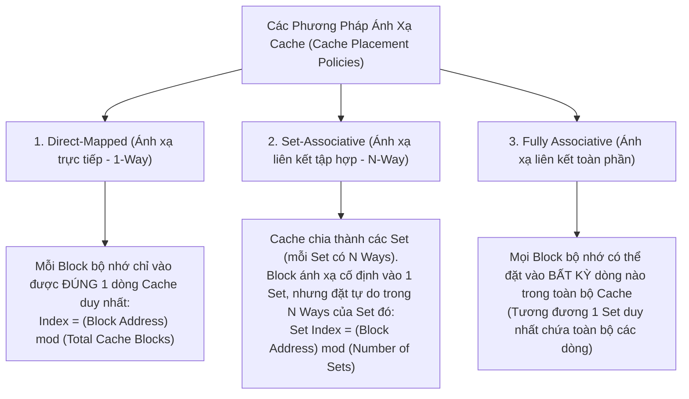

# Tài Liệu 01: Cơ Sở Lý Thuyết Toàn Diện Về Bộ Nhớ Đệm (Cache Memory) & Hệ Thống Phân Cấp Bộ Nhớ

> **Tài liệu chuyên khảo phục vụ Đồ án Kiến trúc Máy tính (KTMT)**  
> **Đối chiếu chuẩn học thuật**: Giáo trình *Computer Organization and Design: The Hardware/Software Interface* (David A. Patterson & John L. Hennessy – Chương 5: *Large and Fast: Exploiting Memory Hierarchy*, Mục 5.3, 5.4 và 5.5 trong file [`5.3-5.4.pdf`](file:///c:/Users/LAM%20QUY%20DO/Downloads/project_KTMT/5.3-5.4.pdf)).

---

## Mục Lục
1. [Tổng quan về Phân cấp Bộ nhớ & Nguyên lý Cục bộ (Principle of Locality)](#1-tổng-quan-về-phân-cấp-bộ-nhớ--nguyên-lý-cục-bộ-principle-of-locality)
2. [Các Phương pháp Tổ chức & Ánh xạ Bộ nhớ Đệm (Cache Mapping)](#2-các-phương-pháp-tổ-chức--ánh-xạ-bộ-nhớ-đệm-cache-mapping)
3. [Giải mã Địa chỉ 32-bit & Tính toán Dung lượng Thực tế của Cache](#3-giải-mã-địa-chỉ-32-bit--tính-toán-dung-lượng-thực-tế-của-cache)
4. [Xử lý Cache Miss, Chính sách Ghi (Write Policies) & Thay thế (LRU)](#4-xử-lý-cache-miss-chính-sách-ghi-write-policies--thay-thế-lru)
5. [Đo lường và Cải thiện Hiệu năng Cache (Mục 5.4)](#5-đo-lường-và-cải-thiện-hiệu-năng-cache-mục-54)
6. [Tối ưu hóa Phần mềm thông qua Kỹ thuật Chia khối (Cache Blocking - DGEMM)](#6-tối-ưu-hóa-phần-mềm-thông-qua-kỹ-thuật-chia-khối-cache-blocking---dgemm)
7. [Độ tin cậy của Hệ thống Bộ nhớ & Mã Sửa lỗi Hamming SEC/DED (Mục 5.5)](#7-độ-tin-cậy-của-hệ-thống-bộ-nhớ--mã-sửa-lỗi-hamming-secded-mục-55)

---

## 1. Tổng quan về Phân cấp Bộ nhớ & Nguyên lý Cục bộ (Principle of Locality)

### 1.1. Khoảng cách Hiệu năng CPU – DRAM (Memory Wall)
Trong kiến trúc máy tính hiện đại, tốc độ xử lý của vi xử lý (CPU) tăng nhanh hơn rất nhiều so với tốc độ truy cập của bộ nhớ chính (DRAM). Một chu kỳ lệnh của CPU chỉ mất khoảng $0.25\text{ ns} - 1\text{ ns}$, trong khi một lần truy cập DRAM mất từ $50\text{ ns} - 100\text{ ns}$ (tương đương hàng trăm chu kỳ xung nhịp CPU). Nếu mọi lệnh đọc/ghi dữ liệu đều phải truy cập trực tiếp xuống DRAM, CPU sẽ dành phần lớn thời gian ở trạng thái chờ (**Memory Stall**).

Để giải quyết bài toán này, các kiến trúc sư máy tính xây dựng **Hệ thống Phân cấp Bộ nhớ (Memory Hierarchy)**, đặt một bộ nhớ SRAM nhỏ nhưng cực nhanh gọi là **Cache (Bộ nhớ đệm)** nằm ngay giữa CPU và DRAM.

### 1.2. Nguyên lý Cục bộ (Principle of Locality)
Cache hoạt động hiệu quả (tỷ lệ đoán trúng thường đạt $> 95\%$) nhờ khai thác **Nguyên lý Cục bộ** của chương trình máy tính:
1. **Tính cục bộ về thời gian (Temporal Locality)**: Nếu một vùng nhớ (lệnh hoặc dữ liệu) vừa được CPU truy cập, khả năng rất cao nó sẽ được truy cập lại trong tương lai gần (ví dụ: các biến đếm, các lệnh nằm trong vòng lặp `for`/`while`).
   - *Cách Cache khai thác*: Giữ lại các khối dữ liệu vừa được truy cập ở trong Cache và chỉ trục xuất các khối đã lâu không được dùng đến (**LRU**).
2. **Tính cục bộ về không gian (Spatial Locality)**: Nếu một địa chỉ bộ nhớ được truy cập, các địa chỉ nằm lân cận nó cũng có xác suất rất cao sẽ được truy cập tiếp theo (ví dụ: duyệt mảng tuần tự, thực thi tuần tự các lệnh chương trình).
   - *Cách Cache khai thác*: Khi xảy ra Cache Miss tại một từ (Word), thay vì chỉ lấy đúng 1 Word (4 Bytes) từ DRAM, bộ điều khiển Cache sẽ nạp cả một **Khối / Dòng nhớ (Cache Block / Cache Line)** gồm nhiều Word liên tiếp nhau (trong đồ án này là **16 Bytes = 4 Words** trên một dòng).

### 1.3. Các khái niệm cơ bản
- **Cache Hit (Đoán trúng)**: Dữ liệu CPU yêu cầu đang có mặt và hợp lệ (`Valid = 1`, `Tag` khớp) trong Cache. Giao dịch hoàn tất ngay lập tức (trong đồ án là **1 chu kỳ xung nhịp**).
- **Cache Miss (Đoán trượt / Lỗi Cache)**: Dữ liệu CPU yêu cầu không có trong Cache. Bộ điều khiển phải tạm dừng CPU (`cpu_ready = 0` / **CPU Stall**), truy cập xuống DRAM để lấy khối dữ liệu về nạp vào Cache, sau đó mới trả dữ liệu cho CPU.
- **Hit Rate (Tỷ lệ trúng)** & **Miss Rate (Tỷ lệ trượt)**:
  $$\text{Hit Rate} = \frac{\text{Số lần Hit}}{\text{Tổng số lần truy cập}}, \qquad \text{Miss Rate} = 1 - \text{Hit Rate} = \frac{\text{Số lần Miss}}{\text{Tổng số lần truy cập}}$$
- **Hit Time**: Thời gian để kiểm tra Tag và đọc/ghi dữ liệu khi Hit (1 chu kỳ).
- **Miss Penalty (Hình phạt khi trượt)**: Số chu kỳ CPU phải dừng hoạt động (Stall) để chờ xử lý xong một lần Miss từ bộ nhớ cấp dưới (DRAM).

---

## 2. Các Phương pháp Tổ chức & Ánh xạ Bộ nhớ Đệm (Cache Mapping)

Khi nạp một khối dữ liệu (Block) từ DRAM lên Cache, câu hỏi cốt lõi là: **Khối dữ liệu đó được phép đặt vào vị trí nào trong Cache?** Có 3 phương pháp ánh xạ kinh điển (Mục 5.3 & 5.4 trong [`5.3-5.4.pdf`](file:///c:/Users/LAM%20QUY%20DO/Downloads/project_KTMT/5.3-5.4.pdf)):



### 2.1. Direct-Mapped Cache (Ánh xạ trực tiếp – 1-Way)
- Mỗi khối bộ nhớ ở DRAM chỉ có **đúng 1 vị trí duy nhất** trong Cache:
  $$\text{Cache Block Index} = (\text{Block Address}) \bmod (\text{Tổng số Block trong Cache})$$
- **Ưu điểm**: Phần cứng cực kỳ đơn giản, chỉ cần **1 bộ so sánh Tag (Comparator)**, không cần mạch chọn kênh (Multiplexor) giữa các Way, không cần thuật toán thay thế.
- **Nhược điểm**: Tỷ lệ **Conflict Miss (Trượt do xung đột)** rất cao. Nếu chương trình truy cập luân phiên 2 địa chỉ cùng ánh xạ vào một chỉ số `Index`, chúng sẽ liên tục đá nhau ra khỏi Cache (hiện tượng **Ping-Pong / Thrashing**) dù toàn bộ các dòng khác của Cache đang trống.

### 2.2. Fully Associative Cache (Ánh xạ liên kết toàn phần)
- Một khối dữ liệu từ DRAM có thể đặt vào **bất kỳ dòng nào** trong Cache.
- **Ưu điểm**: Triệt tiêu hoàn toàn Conflict Miss, đạt Miss Rate thấp nhất.
- **Nhược điểm**: Để tìm dữ liệu, phần cứng phải so sánh `Tag` song song trên **tất cả các dòng** cùng lúc (đòi hỏi hàng trăm bộ Comparator hoặc bộ nhớ CAM đắt đỏ, tốn diện tích silicon và năng lượng, làm tăng thời gian Hit Time). Chỉ thực tế cho các bộ đệm rất nhỏ (như TLB từ 32–64 mục).

### 2.3. $N$-Way Set-Associative Cache (Ánh xạ liên kết tập hợp $N$ đường)
Đây là sự dung hòa hoàn hảo giữa Direct-Mapped và Fully Associative, được sử dụng trong hầu hết các bộ vi xử lý thương mại hiện nay cũng như trong **Đồ án KTMT này ($N = 2$)**:
- Toàn bộ các dòng Cache được chia thành các **Tập hợp (Sets)**, mỗi Set chứa đúng **$N$ dòng (gọi là $N$ Ways)**.
- Một khối bộ nhớ được ánh xạ cố định vào một Set theo phép chia lấy dư:
  $$\text{Set Index} = (\text{Block Address}) \bmod (\text{Số lượng Sets trong Cache})$$
- Bên trong Set được chọn, khối dữ liệu có thể nằm ở **bất kỳ Way nào trong $N$ Ways**. Khi tìm kiếm, phần cứng dùng `Set Index` để trỏ tới đúng hàng (Set) trong SRAM, đọc đồng thời $N$ giá trị Tag từ $N$ Ways và dùng **$N$ bộ so sánh (Comparators)** hoạt động song song.
- Theo số liệu thực nghiệm SPEC CPU2000 trong giáo trình (Hình 5.16, trang 407 [`5.3-5.4.pdf`](file:///c:/Users/LAM%20QUY%20DO/Downloads/project_KTMT/5.3-5.4.pdf)), chỉ cần nâng từ **1-Way (Direct-Mapped)** lên **2-Way Set-Associative** đã giúp giảm khoảng **15% tỷ lệ Miss Rate** với chi phí phần cứng tăng thêm rất nhỏ!

---

## 3. Giải mã Địa chỉ 32-bit & Tính toán Dung lượng Thực tế của Cache

### 3.1. Phân tích Bài toán Thiết kế của Đồ án (`cache_defines.vh`)
Đồ án thiết kế bộ nhớ đệm có các thông số:
- **Dung lượng dữ liệu ($C$)**: $4\text{ KB} = 4096\text{ Bytes} = 2^{12}\text{ Bytes}$.
- **Kích thước một dòng Cache ($B$ - Block/Line Size)**: $16\text{ Bytes} = 4\text{ Words} \times 4\text{ Bytes/Word} = 128\text{ bits}$.
- **Độ kết hợp ($N$ - Associativity)**: $2\text{-Way Set-Associative}$ ($N = 2$).
- **Độ rộng địa chỉ vật lý**: $32\text{ bits}$ (`cpu_addr[31:0]`).

Từ các thông số trên, ta suy ra cấu trúc tổ chức bộ nhớ đệm:
1. **Tổng số dòng Cache (Total Cache Lines)**:
   $$L = \frac{C}{B} = \frac{4096}{16} = 256\text{ dòng (lines)}$$
2. **Tổng số tập hợp (Number of Sets - $S$)**:
   $$S = \frac{L}{N} = \frac{256}{2} = 128\text{ Sets} = 2^7\text{ Sets}$$
3. **Phân tách các trường bit của Địa chỉ 32-bit (`cpu_addr[31:0]`)**:
   - **Byte Offset (`[1:0]` – 2 bits)**: Chọn 1 Byte trong 1 Word 4 Bytes ($\log_2(4) = 2\text{ bits}$). Vì giao tiếp CPU đọc/ghi theo từng Word 32-bit căn chỉnh (word-aligned), 2 bit này luôn bằng `2'b00`.
   - **Word Offset / Word Select (`[3:2]` – 2 bits)**: Chọn 1 Word (32-bit) trong 4 Words của một dòng 16 Bytes ($\log_2(4) = 2\text{ bits}$).
     - Hợp của `Word Select [3:2]` và `Byte Offset [1:0]` tạo thành **Block Offset (`[3:0]` – 4 bits)** vì $\log_2(16\text{ Bytes}) = 4\text{ bits}$.
   - **Set Index (`[10:4]` – 7 bits)**: Dùng để định địa chỉ chọn 1 trong 128 Sets ($\log_2(128) = 7\text{ bits}$).
   - **Tag (`[31:11]` – 21 bits)**: Các bit địa chỉ bậc cao còn lại dùng để định danh duy nhất khối nhớ khi nhiều khối cùng ánh xạ vào một Set:
     $$\text{Tag Width} = 32 - (\text{Index Width} + \text{Block Offset Width}) = 32 - (7 + 4) = 21\text{ bits}$$

```text
+-----------------------------------+-------------------+------------------+------------------+
|             TAG (21 bits)         |  INDEX (7 bits)   | WORD SEL (2 bits)| BYTE OFF (2 bits)|
|              bits [31:11]         |    bits [10:4]    |    bits [3:2]    |    bits [1:0]    |
+-----------------------------------+-------------------+------------------+------------------+
  So sánh song song với Tag0 & Tag1   Chọn 1 trong 128    Chọn 1 trong 4     Chọn Byte trong
  để kiểm tra Hit hay Miss            Sets của Cache      Words (32-bit)     Word (Aligned=00)
```

### 3.2. Công thức Tính Tổng Số Bit Vật lý (Total Physical Bits in Cache)
Theo quy ước tên gọi kiến trúc máy tính, khi gọi **"4KB Cache"**, con số $4\text{ KB}$ ($32,768\text{ bits}$) chỉ tính phần dung lượng lưu trữ dữ liệu thuần túy (**Data Array**). Trong thực tế phần cứng (xem Mục 5.3 trang 389–390 và Mục 5.4 trang 409 [`5.3-5.4.pdf`](file:///c:/Users/LAM%20QUY%20DO/Downloads/project_KTMT/5.3-5.4.pdf)), bộ nhớ Cache còn phải lưu trữ các bit siêu dữ liệu (**Metadata**):
- **Valid bit ($1\text{ bit/line}$)**: Cho biết dòng Cache có chứa dữ liệu hợp lệ hay đang trống (khi mới khởi động/Reset, toàn bộ `Valid = 0`).
- **Dirty bit ($1\text{ bit/line}$)**: Bắt buộc đối với chính sách **Write-Back**, cho biết dữ liệu trong dòng Cache đã bị CPU ghi đè (khác với DRAM) hay chưa.
- **Tag bits ($21\text{ bits/line}$)**: Lưu trường địa chỉ Tag.
- **LRU bit ($1\text{ bit/set}$)**: Lưu trạng thái đường nào ít được dùng gần đây nhất trong mỗi Set.

Tổng số bit SRAM vật lý cần thiết cho bộ **4KB 2-Way Set-Associative Write-Back Cache** của đồ án là:
$$\begin{aligned}
\text{Total Bits} &= S \times \Big[ N \times \left(\text{Data Line Bits} + \text{Tag Bits} + \text{Valid Bit} + \text{Dirty Bit}\right) + \text{LRU Bit} \Big] \\
&= 128 \times \Big[ 2 \times (128 + 21 + 1 + 1) + 1 \Big] \\
&= 128 \times \Big[ 2 \times 151 + 1 \Big] = 128 \times 303 = \mathbf{38,784\text{ bits}} \approx 4.73\text{ KiB}
\end{aligned}$$
Như vậy, phần siêu dữ liệu điều khiển (Tag + Valid + Dirty + LRU) chiếm $6,016\text{ bits}$ (tương đương **18.36%** so với dung lượng dữ liệu 4KB).

---

## 4. Xử lý Cache Miss, Chính sách Ghi (Write Policies) & Thay thế (LRU)

### 4.1. Phân loại 3C của Cache Misses (The Three Cs)
Mọi trường hợp Cache Miss đều thuộc một trong 3 nguyên nhân (3Cs):
1. **Compulsory Miss (Cold Miss – Trượt bắt buộc/khởi tạo)**: Xảy ra khi một khối nhớ được truy cập **lần đầu tiên** trong chương trình (khi đó dòng Cache tương ứng đang có `Valid = 0`). Không thể tránh khỏi nếu không nạp trước (Prefetching) hoặc tăng kích thước dòng.
2. **Capacity Miss (Trượt do dung lượng)**: Xảy ra khi tập làm việc (Working Set) của chương trình lớn hơn tổng dung lượng của Cache ($4\text{ KB}$), khiến các khối từng được nạp vào bị đẩy ra hết và sau đó được gọi lại (ví dụ: nhân hai ma trận lớn).
3. **Conflict Miss (Collision Miss – Trượt do xung đột)**: Xảy ra trong Cache Direct-Mapped hoặc Set-Associative khi nhiều khối nhớ khác nhau cùng ánh xạ vào **cùng một Set** (vượt quá số Way $N$ của Set đó), dẫn đến việc đá nhau ra mặc dù các Set khác trong Cache vẫn còn trống.

### 4.2. Các Kỹ thuật Giảm Hình phạt khi Trượt (Reducing Miss Penalty – Mục 5.3, trang 392)
Khi kích thước dòng Cache lớn (nhiều Word trên 1 dòng), để giảm thời gian CPU phải chờ:
- **Early Restart (Khởi động lại sớm)**: Ngay khi Word mà CPU yêu cầu được đọc về tới nơi trong quá trình truyền chuỗi (burst transfer), Cache lập tức trả Word đó cho CPU tiếp tục chạy mà không cần đợi nạp xong toàn bộ các Word còn lại của dòng.
- **Requested Word First / Critical Word First (Ưu tiên từ quan trọng trước)**: Bộ nhớ chính tổ chức gửi đúng Word mà CPU đang cần về trước tiên, sau đó mới truyền vòng quanh (wrap-around) các Word còn lại của dòng Cache.
- *Lưu ý trong đồ án*: Giao diện giữa `cache_top` và `main_memory_model` sử dụng **Bus dữ liệu rộng 128-bit (`mem_rdata[127:0]`)** truyền song song toàn bộ dòng 16 Bytes trong một giao dịch burst, kết hợp mạch chọn kênh `sel_refill_data` đưa thẳng từ vừa nạp ra `cpu_rdata` ngay tại chu kỳ `STATE_REFILL_UPDATE`.

### 4.3. Chính sách Ghi (Write Policies)
Xử lý thao tác Ghi (`cpu_we = 1`) phức tạp hơn thao tác Đọc rất nhiều vì phải đảm bảo **tính nhất quán dữ liệu (Data Consistency)** giữa Cache và DRAM, đồng thời tuyệt đối không được ghi đè dữ liệu vào SRAM trước khi kiểm tra xong Tag (nếu ghi mù như Direct-Mapped Write-Through sẽ làm hỏng dữ liệu của địa chỉ khác!).

#### A. Khi Ghi Trúng (Write Hit): Write-Through vs. Write-Back
| Tiêu chí | Write-Through (Ghi xuyên) | Write-Back (Ghi trả sau – **Sử dụng trong Đồ án**) |
| :--- | :--- | :--- |
| **Nguyên lý** | Mọi lệnh ghi của CPU đều cập nhật **đồng thời** vào cả Cache và DRAM (hoặc đẩy vào hàng đợi *Write Buffer*). | Lệnh ghi chỉ cập nhật vào dòng trong Cache và bật cờ **`Dirty = 1`**. DRAM không bị truy cập. |
| **Khi bị trục xuất (Eviction)** | Dòng trong Cache luôn giống hệt DRAM nên có thể ghi đè ngay lập tức, không cần ghi trả. | Nếu dòng nạn nhân có **`Dirty == 1`**, bộ điều khiển bắt buộc phải ghi trả (**Write-Back**) dòng 128-bit đó xuống DRAM trước khi nạp dòng mới đè lên. |
| **Hiệu năng & Băng thông** | Tốn băng thông bus bộ nhớ; nếu Write Buffer đầy sẽ gây dừng CPU (Write Buffer Stall). | **Tốc độ ghi cực nhanh (1 chu kỳ)**; gom nhiều lần ghi trên cùng 1 dòng thành **1 lần ghi duy nhất** xuống DRAM khi bị thay thế, tiết kiệm tối đa băng thông bộ nhớ. |

#### B. Khi Ghi Trượt (Write Miss): Write-Allocate vs. No-Write-Allocate
- **Write-Allocate (Fetch-on-Write – Sử dụng trong Đồ án)**: Khi lệnh ghi bị Miss, bộ điều khiển thực hiện giống như Read Miss (nếu dòng nạn nhân bẩn thì Write-Back trước), sau đó **nạp toàn bộ dòng 128-bit từ DRAM lên**, trộn (**merge**) từ 32-bit mới của CPU vào đúng vị trí `Word Offset`, ghi cả dòng vào Cache và đánh dấu **`Dirty = 1`**. Chính sách này kết hợp tự nhiên với **Write-Back** để khai thác tính cục bộ không gian/thời gian cho các truy cập tiếp theo vào cùng dòng đó.
- **No-Write-Allocate (Write-Around)**: Chỉ ghi thẳng xuống DRAM mà không nạp dòng đó lên Cache (thường đi kèm với Write-Through).

### 4.4. Chính sách Thay thế LRU (Least Recently Used) trong 2-Way Set-Associative Cache
Khi xảy ra Cache Miss tại một Set `index`, bộ điều khiển phải chọn **1 trong 2 Way** (`Way 0` hoặc `Way 1`) làm **Đường nạn nhân (Victim Way)** để chứa dòng mới:
1. **Quy tắc ưu tiên dòng trống (Invalid Line Priority)**:
   - Nếu `Way 0` đang trống (`valid0 == 0`) $\to$ Chọn `victim_way = 0`.
   - Ngược lại, nếu `Way 1` đang trống (`valid1 == 0`) $\to$ Chọn `victim_way = 1`.
2. **Quy tắc LRU chính xác bằng 1-bit trạng thái (`lru_bit`)**:
   - Khi cả 2 Way đều đã có dữ liệu hợp lệ (`valid0 == 1 && valid1 == 1`), mỗi Set chỉ cần duy trì **1 bit duy nhất** (`lru_mem[index]`):
     - `lru_bit == 0`: `Way 0` là ít được dùng gần đây nhất (**LRU**), `Way 1` là vừa mới dùng gần đây nhất (**MRU**).
     - `lru_bit == 1`: `Way 1` là **LRU**, `Way 0` là **MRU**.
   - **Quy tắc cập nhật**: Bất cứ khi nào có một truy cập thành công (Hit hoặc vừa Refill xong) vào đường `access_way` ($\in \{0, 1\}$), đường còn lại sẽ trở thành LRU:
     $$\text{lru\_mem}[\text{index}] \Leftarrow \sim\text{access\_way}$$

---

## 5. Đo lường và Cải thiện Hiệu năng Cache (Mục 5.4)

### 5.1. Phương trình Thời gian Thực thi CPU có Chu kỳ Chờ Bộ nhớ (CPU Time with Memory Stalls)
Theo Mục 5.4 (trang 399–401 [`5.3-5.4.pdf`](file:///c:/Users/LAM%20QUY%20DO/Downloads/project_KTMT/5.3-5.4.pdf)), thời gian thực thi của CPU được tính bởi:
$$\text{CPU Time} = \left(\text{CPU Execution Clock Cycles} + \text{Memory-Stall Clock Cycles}\right) \times \text{Clock Cycle Time}$$

Trong đó:
$$\text{Memory-Stall Clock Cycles} = \text{Read-Stall Cycles} + \text{Write-Stall Cycles}$$
Nếu tính theo số lệnh chương trình ($I = \text{Instruction Count}$):
$$\text{Memory-Stall Clock Cycles} = I \times \frac{\text{Misses}}{\text{Instruction}} \times \text{Miss Penalty}$$
Và số chu kỳ trung bình trên mỗi lệnh thực tế ($\text{CPI}_{\text{stall}}$) là:
$$\text{CPI}_{\text{stall}} = \text{CPI}_{\text{base}} + \text{Memory-Stall Cycles per Instruction}$$

> [!IMPORTANT]
> **Hệ quả của Định luật Amdahl (Trang 401 [`5.3-5.4.pdf`](file:///c:/Users/LAM%20QUY%20DO/Downloads/project_KTMT/5.3-5.4.pdf))**: Khi cải tiến đường ống (Pipeline) làm giảm $\text{CPI}_{\text{base}}$ (ví dụ từ $2.0$ xuống $1.0$) hoặc tăng tần số xung nhịp CPU mà không cải thiện tốc độ hệ thống bộ nhớ, **tỷ trọng thời gian CPU bị đình trệ vì Cache Miss ($\text{Memory Stall} / \text{Total CPI}$) sẽ tăng vọt** (ví dụ từ $63\%$ lên $77\%$). Do đó, thiết kế Cache quyết định trực tiếp hiệu năng thực tế của vi xử lý!

### 5.2. Thời gian Truy cập Bộ nhớ Trung bình (AMAT – Average Memory Access Time)
Để đánh giá toàn diện một thiết kế Cache (xét cả Hit Time, Miss Rate và Miss Penalty), các nhà thiết kế sử dụng đại lượng **AMAT** (Trang 402 [`5.3-5.4.pdf`](file:///c:/Users/LAM%20QUY%20DO/Downloads/project_KTMT/5.3-5.4.pdf)):
$$\text{AMAT} = \text{Time for a Hit} + \text{Miss Rate} \times \text{Miss Penalty}$$

Đối với kiến trúc **Write-Back Cache** như trong đồ án, một lần Miss có thể là **Clean Miss** (nạn nhân sạch, chỉ tốn thời gian Fetch $\text{Penalty}_{\text{clean}}$) hoặc **Dirty Miss** (nạn nhân bẩn, tốn thêm thời gian Write-Back $\text{Penalty}_{\text{wb}}$). Khi đó công thức AMAT tổng quát chính xác là:
$$\text{AMAT} = \text{Hit Time} + \text{Miss Rate} \times \text{Penalty}_{\text{clean}} + \left(\text{Miss Rate} \times P_{\text{dirty\_victim}}\right) \times \text{Penalty}_{\text{wb}}$$

**Áp dụng thực tế vào kết quả mô phỏng của Đồ án (`tb_cache_top.v`)**:
- $\text{Hit Time} = 1\text{ chu kỳ}$.
- $\text{Penalty}_{\text{clean}} = 9\text{ chu kỳ stall}$ (tổng thời gian Clean Miss = $1 + 9 = 10\text{ chu kỳ}$).
- $\text{Penalty}_{\text{wb}} = 8\text{ chu kỳ stall}$ (tổng thời gian Dirty Miss = $1 + 9 + 8 = 18\text{ chu kỳ}$).
- Với $26$ lần truy cập, có $15$ Hits, $11$ Misses (trong đó có $2$ lần Dirty Write-Back):
  $$\text{AMAT} = 1 + \frac{11}{26} \times 9 + \frac{2}{26} \times 8 = 1 + \frac{99 + 16}{26} = \frac{141}{26} \approx \mathbf{5.42\text{ chu kỳ}} \quad (54.23\text{ ns tại } 100\text{ MHz})$$

### 5.3. Bộ nhớ Đệm Đa mức (Multilevel Caches: L1 & L2 – Mục 5.4, trang 410–411)
Để vừa giữ **Hit Time** cực nhỏ (bằng cách làm Cache L1 nhỏ gọn, độ kết hợp thấp 2-way/4-way), vừa giảm **Miss Penalty** khi L1 bị trượt, các vi xử lý hiện đại bổ sung thêm **Cache mức 2 (L2 Cache)** lớn hơn nằm trên cùng chip:
- **Local Miss Rate (Tỷ lệ trượt cục bộ của L2)**: Số lần Miss tại L2 chia cho số lần truy cập vào L2 (chính là số lần Miss của L1).
- **Global Miss Rate (Tỷ lệ trượt toàn cục)**: Số lần Miss tại L2 chia cho tổng số lần truy cập bộ nhớ của CPU:
  $$\text{Global Miss Rate} = \text{Miss Rate}_{L1} \times \text{Local Miss Rate}_{L2}$$
- **Công thức tổng CPI cho hệ thống Cache 2 mức**:
  $$\text{Total CPI} = \text{CPI}_{\text{base}} + \text{Miss Rate}_{L1} \times \text{Penalty}_{L2} + \text{Global Miss Rate} \times \text{Penalty}_{\text{DRAM}}$$
- **Triết lý thiết kế**:
  - **Primary Cache (L1)**: Tối ưu hóa để **giảm Hit Time** (dung lượng nhỏ 4KB–32KB, kích thước dòng nhỏ hơn, độ kết hợp vừa phải) nhằm rút ngắn chu kỳ xung nhịp CPU.
  - **Secondary Cache (L2/L3)**: Tối ưu hóa để **giảm Miss Rate** (dung lượng lớn 256KB–16MB, kích thước dòng lớn hơn, độ kết hợp cao 8-way/16-way) nhằm tránh phải truy cập xuống DRAM.

---

## 6. Tối ưu hóa Phần mềm thông qua Kỹ thuật Chia khối (Cache Blocking - DGEMM)

Trong Mục 5.4 (trang 411–416 [`5.3-5.4.pdf`](file:///c:/Users/LAM%20QUY%20DO/Downloads/project_KTMT/5.3-5.4.pdf)), giáo trình chỉ ra rằng: **Phân tích độ phức tạp thuật toán cổ điển $O(N)$ thường bỏ qua tác động của phân cấp bộ nhớ**.
- **Ví dụ Quicksort vs. Radix Sort (Hình 5.19)**: Dù Radix Sort thực hiện ít lệnh CPU hơn Quicksort trên mỗi phần tử khi mảng lớn, nhưng thời gian chạy thực tế của Radix Sort lại chậm hơn vì mẫu truy cập bộ nhớ phân tán của Radix Sort gây ra quá nhiều **Cache Misses**!
- **Kỹ thuật Cache Blocking (Loop Tiling) trong nhân ma trận DGEMM ($C = C + A \times B$)**:
  - Khi nhân hai ma trận lớn kích thước $N \times N$ (không vừa trọn trong Cache): Ma trận $A$ được duyệt theo hàng (tận dụng tốt Spatial Locality), nhưng ma trận $B$ bị duyệt theo cột (nhảy bước $N$ phần tử $\to$ gây **Capacity Miss** liên tục nếu $N$ lớn).
  - **Giải pháp Chia khối (Blocking)**: Thay vì nhân toàn bộ hàng và cột độ dài $N$, ta chia ma trận thành các **ma trận con (Submatrices / Blocks)** kích thước $\text{BLOCKSIZE} \times \text{BLOCKSIZE}$ sao cho 3 khối con của $A, B, C$ nằm vừa khít trong dung lượng của Cache.
  - Nhờ đó, dữ liệu của một khối con sau khi nạp vào Cache được tái sử dụng tối đa ($\text{BLOCKSIZE}$ lần) trước khi bị trục xuất, giúp giảm số từ bộ nhớ phải đọc từ DRAM đi một hệ số xấp xỉ $\text{BLOCKSIZE}$ lần!
  - *Kết quả mô phỏng thực tế trên đúng bộ Cache 4KB 2-Way của đồ án* (chạy bằng [`scripts/cache_architectural_suite.py`](file:///c:/Users/LAM%20QUY%20DO/Downloads/project_KTMT/scripts/cache_architectural_suite.py) với ma trận $32 \times 32$): Kỹ thuật Blocking (`BLOCKSIZE = 8`) giúp **giảm 37.4% số lần Cache Miss** (từ $5,446$ xuống $3,408$ misses) và tăng tốc AMAT lên **1.22 lần**!

---

## 7. Độ tin cậy của Hệ thống Bộ nhớ & Mã Sửa lỗi Hamming SEC/DED (Mục 5.5)

Phần cuối của tài liệu tham khảo (Mục 5.5, trang 418–423 [`5.3-5.4.pdf`](file:///c:/Users/LAM%20QUY%20DO/Downloads/project_KTMT/5.3-5.4.pdf)) trình bày cách thiết kế hệ thống bộ nhớ đáng tin cậy (**Dependable Memory Hierarchy**) chống lại các lỗi mềm (Soft Errors) do tia vũ trụ hoặc nhiễu điện từ làm lật bit (bit flip) trong các ô nhớ SRAM/DRAM.

### 7.1. Các thước đo Độ tin cậy (Reliability) và Độ sẵn sàng (Availability)
- **MTTF (Mean Time To Failure)**: Thời gian trung bình giữa các lần xảy ra sự cố (thước đo độ tin cậy – Reliability).
- **AFR (Annual Failure Rate)**: Tỷ lệ phần trăm thiết bị dự kiến hỏng trong 1 năm ($8,760\text{ giờ}$):
  $$\text{AFR} = \frac{8760\text{ giờ}}{\text{MTTF (giờ)}}$$
- **MTTR (Mean Time To Repair)**: Thời gian trung bình để khắc phục/sửa chữa sự cố.
- **MTBF (Mean Time Between Failures)**: $\text{MTBF} = \text{MTTF} + \text{MTTR}$.
- **Availability (Độ sẵn sàng)**:
  $$\text{Availability} = \frac{\text{MTTF}}{\text{MTTF} + \text{MTTR}}$$
- Ba phương pháp nâng cao MTTF: **Fault Avoidance** (Phòng tránh lỗi bằng cấu trúc), **Fault Tolerance** (Chịu lỗi bằng dự phòng – Redundancy như ECC), và **Fault Forecasting** (Dự báo lỗi).

### 7.2. Khoảng cách Hamming & Mã Sửa 1 Lỗi / Phát hiện 2 Lỗi (Hamming SEC/DED ECC)
- **Khoảng cách Hamming (Hamming Distance)**: Số lượng vị trí bit khác nhau tối thiểu giữa hai từ mã hợp lệ bất kỳ.
  - Khoảng cách tối thiểu $d_{\min} = 2$ (ví dụ: thêm **1 bit chẵn lẻ – Parity bit**): Chỉ **phát hiện được lỗi 1 bit (Single Error Detection)** nhưng không biết bit nào sai để sửa, và nếu sai 2 bit thì không phát hiện được.
  - Khoảng cách tối thiểu $d_{\min} = 3$ (**Mã Hamming SEC – Single Error Correcting**): Sửa được mọi lỗi 1 bit. Để bảo vệ $d$ bit dữ liệu bằng $p$ bit kiểm tra chẵn lẻ, số bit $p$ phải thỏa mãn bất đẳng thức:
    $$2^p \ge p + d + 1$$
    *(Ví dụ: Với $d = 8\text{ bits}$ dữ liệu $\to p = 4\text{ bits}$; với $d = 32\text{ bits} \to p = 6\text{ bits}$; với $d = 64\text{ bits} \to p = 7\text{ bits}$)*.
  - Khoảng cách tối thiểu $d_{\min} = 4$ (**Mã Hamming SEC/DED – Single Error Correcting / Double Error Detecting**): Bổ sung thêm **1 bit chẵn lẻ tổng ($p_{\text{all}}$)** tính trên toàn bộ từ mã SEC. Với $64\text{ bits}$ dữ liệu ($8\text{ Bytes}$), chỉ cần $7 + 1 = 8\text{ bits}$ ($1\text{ Byte}$) ECC, tạo thành đường bus DIMM máy chủ rộng $72\text{ bits}$ tiêu chuẩn!

### 7.3. Quy trình Mã hóa & Giải mã Hamming SEC/DED (Đánh số bit từ 1 bên trái)
1. **Vị trí các bit**:
   - Các vị trí là lũy thừa của 2 ($1, 2, 4, 8, 16, \dots$) dành cho các bit kiểm tra chẵn lẻ nhóm ($p_1, p_2, p_4, p_8, \dots$).
   - Các vị trí còn lại ($3, 5, 6, 7, 9, 10, 11, 12, \dots$) chứa các bit dữ liệu ($d_1, d_2, d_3, d_4, \dots$).
   - Vị trí cuối cùng chứa bit chẵn lẻ tổng $p_{\text{all}}$.
2. **Phạm vi kiểm tra (Even Parity)**:
   - $p_1$ (`0001`₂): Kiểm tra các vị trí có bit trọng số $2^0 = 1$ bằng 1 (vị trí $1, 3, 5, 7, 9, 11, \dots$).
   - $p_2$ (`0010`₂): Kiểm tra các vị trí có bit trọng số $2^1 = 2$ bằng 1 (vị trí $2, 3, 6, 7, 10, 11, \dots$).
   - $p_4$ (`0100`₂): Kiểm tra các vị trí có bit trọng số $2^2 = 4$ bằng 1 (vị trí $4, 5, 6, 7, 12, \dots$).
   - $p_8$ (`1000`₂): Kiểm tra các vị trí có bit trọng số $2^3 = 8$ bằng 1 (vị trí $8, 9, 10, 11, 12, \dots$).
3. **Giải mã Syndrome ($H = (p_8 p_4 p_2 p_1)_2$) và Kiểm tra Chẵn lẻ tổng ($P_{\text{all}}$)**:
   - **Trường hợp 1 ($H = 0$ và $P_{\text{all}}$ chẵn)**: Không có lỗi.
   - **Trường hợp 2 ($H \ne 0$ và $P_{\text{all}}$ lẻ)**: Xảy ra **lỗi đơn 1 bit (Single-Bit Error)** tại đúng vị trí có chỉ số thập phân bằng giá trị nhị phân của $H$ $\to$ Đảo bit tại vị trí $H$ để tự động sửa lỗi!
   - **Trường hợp 3 ($H = 0$ và $P_{\text{all}}$ lẻ)**: Lỗi 1 bit xảy ra ngay tại chính bit chẵn lẻ tổng $p_{\text{all}}$ (dữ liệu vẫn đúng).
   - **Trường hợp 4 ($H \ne 0$ và $P_{\text{all}}$ chẵn)**: Phát hiện **lỗi kép 2 bit (Double-Bit Error)** $\to$ Báo hiệu lỗi không thể tự sửa (Uncorrectable Error Exception) để ngăn CPU sử dụng dữ liệu sai!
