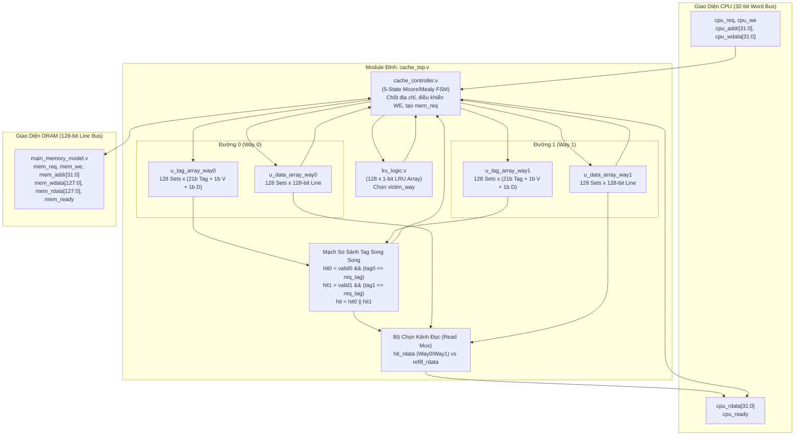

# Tài Liệu 02: Thiết Kế Vi Kiến Trúc Phần Cứng RTL (Verilog) & Máy Trạng Thái Hữu Hạn (FSM)

> **Tài liệu kỹ thuật chuyên sâu giải thích toàn bộ mã nguồn RTL trong thư mục [`rtl/`](file:///b:/KTMT/project_KTMT/rtl)**  
> **Đối tượng**: Sinh viên, kỹ sư thiết kế vi mạch số (Digital IC / FPGA Design) và giảng viên chấm đồ án Kiến trúc máy tính.

---

## Mục Lục
1. [Kiến trúc Tổng thể Hệ thống (`cache_top.v`)](#1-kiến-trúc-tổng-thể-hệ-thống-cache_topv)
2. [Phân tích Chi tiết các Khối Lưu trữ & Logic Phụ trợ](#2-phân-tích-chi-tiết-các-khối-lưu-trữ--logic-phụ-trợ)
3. [Thiết kế Máy Trạng Thái Hữu Hạn 5 Trạng thái (`cache_controller.v`)](#3-thiết-kế-máy-trạng-thái-hữu-hạn-5-trạng-thái-cache_controllerv)
4. [Phân tích Định thời Chuẩn xác Từng Chu kỳ (Cycle-by-Cycle Timing Analysis)](#4-phân-tích-định-thời-chuẩn-xác-từng-chu-kỳ-cycle-by-cycle-timing-analysis)
5. [Phân tích & Khắc phục Lỗi Bắt tay Bus Bộ nhớ (Phantom Memory Transaction Bug)](#5-phân-tích--khắc-phục-lỗi-bắt-tay-bus-bộ-nhớ-phantom-memory-transaction-bug)

---

## 1. Kiến trúc Tổng thể Hệ thống (`cache_top.v`)

Bộ nhớ đệm **4KB 2-Way Set-Associative Cache** được thiết kế theo phương pháp phân rã mô-đun rõ ràng giữa **Khối Điều khiển (Control Path)** và **Khối Đường dữ liệu (Datapath)** tại module đỉnh [`rtl/cache_top.v`](file:///b:/KTMT/project_KTMT/rtl/cache_top.v).

### 1.1. Sơ đồ Khối Vi kiến trúc (Microarchitecture Block Diagram)



### 1.2. Cơ chế Chọn Chỉ số Set (`current_index`) và Chỉ số Word (`current_word_idx`)
Trong [`rtl/cache_top.v`](file:///b:/KTMT/project_KTMT/rtl/cache_top.v#L67-L73):
```verilog
wire [INDEX_WIDTH-1:0]    current_index = (state_out == `STATE_IDLE) ? 
                                          cpu_addr[`INDEX_MSB:`INDEX_LSB] : 
                                          latched_addr[`INDEX_MSB:`INDEX_LSB];

wire [WORD_SEL_WIDTH-1:0] current_word_idx = (state_out == `STATE_IDLE) ? 
                                             cpu_addr[`WORD_SEL_MSB:`WORD_SEL_LSB] : 
                                             latched_addr[`WORD_SEL_MSB:`WORD_SEL_LSB];
```
- **Ý nghĩa thiết kế**: Ngay khi FSM đã rời khỏi trạng thái `STATE_IDLE` để xử lý yêu cầu (`STATE_COMPARE_TAG`, `STATE_WRITE_BACK`, `STATE_FETCH_MEM`, `STATE_REFILL_UPDATE`), địa chỉ truy cập vào các mảng SRAM được lấy từ **thanh ghi chốt `latched_addr`** bên trong bộ điều khiển. Điều này bảo vệ hoàn toàn quá trình xử lý nhiều chu kỳ của Cache khỏi mọi sự biến thiên trên đường bus `cpu_addr` của CPU trong lúc CPU đang bị dừng (`cpu_ready = 0`).

### 1.3. Mạch So sánh Tag Song song (Parallel Tag Comparators)
Đúng theo cấu trúc Hình 5.18 trong giáo trình (trang 408 [`5.3-5.4.pdf`](file:///b:/KTMT/project_KTMT/5.3-5.4.pdf)), hai bộ so sánh 21-bit hoạt động song song với cổng `AND` kiểm tra bit `valid` tại [`rtl/cache_top.v`](file:///b:/KTMT/project_KTMT/rtl/cache_top.v#L95-L99):
```verilog
wire [TAG_WIDTH-1:0] req_tag = latched_addr[`TAG_MSB:`TAG_LSB];
wire hit0 = valid0 && (tag0 == req_tag);
wire hit1 = valid1 && (tag1 == req_tag);
wire hit  = hit0 || hit1;
wire hit_way = hit1; // 0 nếu trúng Way 0, 1 nếu trúng Way 1
```
- Do một khối dữ liệu không bao giờ nằm trùng lặp ở cả hai Way của cùng một Set, `hit0` và `hit1` loại trừ lẫn nhau. Do đó tín hiệu `hit_way` chỉ cần gán trực tiếp bằng `hit1` (`hit1 == 1` nghĩa là trúng Way 1, ngược lại khi `hit == 1` mà `hit1 == 0` thì chắc chắn trúng Way 0).

---

## 2. Phân tích Chi tiết các Khối Lưu trữ & Logic Phụ trợ

### 2.1. Khối Tham số Toàn cục ([`rtl/cache_defines.vh`](file:///b:/KTMT/project_KTMT/rtl/cache_defines.vh))
Tập trung toàn bộ các hằng số kiến trúc (`ADDR_WIDTH = 32`, `DATA_WIDTH = 32`, `LINE_WIDTH = 128`, `NUM_SETS = 128`, `TAG_WIDTH = 21`, `INDEX_WIDTH = 7`, `WORD_SEL_WIDTH = 2`) và mã hóa 5 trạng thái FSM. Nhờ thiết kế tham số hóa (`parameter`), việc mở rộng dung lượng Cache (ví dụ lên 8KB hoặc 16KB) chỉ cần thay đổi file header này.

### 2.2. Khối Mảng Thẻ Địa chỉ ([`rtl/tag_array.v`](file:///b:/KTMT/project_KTMT/rtl/tag_array.v))
Mỗi thực thể `tag_array` đại diện cho 1 Way (chứa 128 dòng):
- **Ba mảng thanh ghi**: `tag_mem[0:127]` (21-bit), `valid_mem[0:127]` (1-bit), `dirty_mem[0:127]` (1-bit).
- **Cơ chế Ghi đồng bộ (`posedge clk`)**:
  - Khi `rst_n == 0`: Xóa toàn bộ `valid_mem[i] <= 0`, `dirty_mem[i] <= 0` để đảm bảo trạng thái khởi động sạch (Cold Cache).
  - Khi `tag_we == 1` (xảy ra ở trạng thái `STATE_REFILL_UPDATE`): Ghi `tag_in` vào `tag_mem[index]` và tự động bật `valid_mem[index] <= 1'b1`.
  - Khi `dirty_we == 1`: Cập nhật `dirty_mem[index] <= dirty_in` (`dirty_in = 1` khi Write Hit hoặc Write-Allocate; `dirty_in = 0` khi nạp dòng mới do Read Miss).
- **Cơ chế Đọc tổ hợp (Asynchronous/Combinational Read)**:
  - `assign tag_out = tag_mem[index];` cho phép kiểm tra Tag ngay trong chu kỳ `STATE_COMPARE_TAG` mà không bị trễ thêm 1 chu kỳ đọc SRAM.

### 2.3. Khối Mảng Dữ liệu ([`rtl/data_array.v`](file:///b:/KTMT/project_KTMT/rtl/data_array.v))
Mỗi thực thể `data_array` lưu trữ $128\text{ Sets} \times 128\text{ bits} = 2\text{ KB}$ dữ liệu (2 Way cộng lại đúng bằng **4 KB**):
- **Hai chế độ Ghi đồng bộ**:
  1. **Ghi toàn dòng 128-bit (`line_we == 1`)**: Dùng khi nạp dòng mới từ DRAM (`data_mem[index] <= line_in`).
  2. **Ghi từng từ 32-bit (`word_we == 1`)**: Dùng khi xảy ra **Write Hit**, chỉ cập nhật đúng lát cắt 32-bit tương ứng với `word_idx` (`[31:0]`, `[63:32]`, `[95:64]` hoặc `[127:96]`), giữ nguyên 3 từ 32-bit còn lại trong dòng.
- **Hai cổng Đọc tổ hợp**:
  1. `line_out[127:0]`: Xuất toàn bộ dòng 128-bit để phục vụ ghi trả (**Write-Back**) xuống DRAM khi dòng bẩn bị trục xuất.
  2. `word_out[31:0]`: Qua bộ chọn kênh 4-sang-1 điều khiển bởi `word_idx[1:0]` để trả đúng Word 32-bit mà CPU cần đọc.

### 2.4. Khối Logic Thay thế LRU ([`rtl/lru_logic.v`](file:///b:/KTMT/project_KTMT/rtl/lru_logic.v))
- Duy trì mảng 128 bit `lru_mem[0:127]`.
- **Logic chọn đường nạn nhân (`victim_way`)**:
  ```verilog
  always @(*) begin
      if (!valid0) begin
          victim_way = 1'b0;       // Ưu tiên 1: Nếu Way 0 đang trống, cấp phát vào Way 0
      end else if (!valid1) begin
          victim_way = 1'b1;       // Ưu tiên 2: Nếu Way 1 đang trống, cấp phát vào Way 1
      end else begin
          victim_way = lru_bit;    // Ưu tiên 3: Cả 2 Way đều đầy -> chọn theo bit LRU
      end
  end
  ```
- **Logic cập nhật (`lru_update == 1`)**: Thực hiện tại sườn lên xung nhịp khi kết thúc một lần Hit (`STATE_COMPARE_TAG`) hoặc khi hoàn tất nạp dòng mới (`STATE_REFILL_UPDATE`):
  ```verilog
  lru_mem[index] <= ~access_way; // Nếu vừa dùng Way 0 thì Way 1 thành LRU (1), và ngược lại
  ```

---

## 3. Thiết kế Máy Trạng Thái Hữu Hạn 5 Trạng thái (`cache_controller.v`)

Bộ điều khiển trung tâm [`rtl/cache_controller.v`](file:///b:/KTMT/project_KTMT/rtl/cache_controller.v) điều phối mọi hoạt động của Cache thông qua một **FSM gồm 5 trạng thái**:

### 3.1. Lưu đồ Chuyển Trạng thái FSM (State Transition Diagram)

```mermaid
stateDiagram-v2
    [*] --> STATE_IDLE : Reset (rst_n = 0)
    STATE_IDLE --> STATE_IDLE : cpu_req = 0
    STATE_IDLE --> STATE_COMPARE_TAG : cpu_req = 1\n(Chốt cpu_addr, cpu_wdata, cpu_we)

    STATE_COMPARE_TAG --> STATE_IDLE : hit = 1\n(cpu_ready = 1, cập nhật LRU;\nnếu Write Hit thì ghi Word & bật Dirty = 1)
    STATE_COMPARE_TAG --> STATE_FETCH_MEM : hit = 0 && victim_dirty = 0\n(Clean Miss: Chốt thông tin Victim,\nbỏ qua Write-Back)
    STATE_COMPARE_TAG --> STATE_WRITE_BACK : hit = 0 && victim_dirty = 1\n(Dirty Miss: Chốt Tag & Data 128b của Victim)

    STATE_WRITE_BACK --> STATE_WRITE_BACK : mem_ready = 0\n(mem_req = 1, mem_we = 1,\nGhi dòng bẩn 128b về DRAM)
    STATE_WRITE_BACK --> STATE_FETCH_MEM : mem_ready = 1\n(Hoàn tất Write-Back)

    STATE_FETCH_MEM --> STATE_FETCH_MEM : mem_ready = 0\n(mem_req = 1, mem_we = 0,\nĐọc dòng mới 128b từ DRAM)
    STATE_FETCH_MEM --> STATE_REFILL_UPDATE : mem_ready = 1\n(Chốt latched_mem_rdata <= mem_rdata)

    STATE_REFILL_UPDATE --> STATE_IDLE : Hoàn tất nạp Cache\n(Ghi Line + Tag + Valid + Dirty vào Victim Way,\ncập nhật LRU, xuất cpu_ready = 1)
```



### 3.2. Vai trò Từng Trạng thái & Cơ chế Trộn Dữ liệu Write-Allocate
1. **`STATE_IDLE` (`3'b000`)**:
   - Đợi tín hiệu yêu cầu `cpu_req = 1` từ CPU. Khi phát hiện `cpu_req = 1`, tại sườn lên `posedge clk`, FSM chốt `cpu_addr`, `cpu_wdata`, `cpu_we` vào các thanh ghi `latched_addr`, `latched_wdata`, `latched_we` và chuyển sang `STATE_COMPARE_TAG`.
2. **`STATE_COMPARE_TAG` (`3'b001`)**:
   - Kiểm tra tổ hợp `hit = hit0 || hit1`.
   - **Nếu `hit == 1`**:
     - Báo `cpu_ready = 1`, `lru_update = 1`, `lru_access_way = hit_way`.
     - Nếu là lệnh Ghi (`latched_we == 1` – **Write Hit**): Kích hoạt `word_we` và `dirty_we = 1`, `dirty_in = 1` cho đúng `hit_way`.
     - Quay về `STATE_IDLE` ngay ở chu kỳ kế tiếp (Tổng thời gian xử lý = **1 chu kỳ**).
   - **Nếu `hit == 0` (Cache Miss)**:
     - Giữ `cpu_ready = 0` để dừng CPU (Stall).
     - Chốt toàn bộ thông tin của đường nạn nhân (`latched_victim_way`, `latched_victim_tag`, `latched_victim_data`) vào thanh ghi. Việc chốt này cực kỳ quan trọng để giữ nguyên dữ liệu và địa chỉ của dòng nạn nhân trong suốt quá trình `STATE_WRITE_BACK`.
     - Kiểm tra `victim_dirty = (victim_way == 0) ? (valid0 && dirty0) : (valid1 && dirty1)`:
       - Nếu `victim_dirty == 1` $\to$ Chuyển sang `STATE_WRITE_BACK`.
       - Nếu `victim_dirty == 0` $\to$ Chuyển thẳng sang `STATE_FETCH_MEM`.
3. **`STATE_WRITE_BACK` (`3'b010`)**:
   - Khôi phục địa chỉ vật lý 16-byte aligned của dòng nạn nhân:
     ```verilog
     mem_addr = {latched_victim_tag, latched_addr[`INDEX_MSB:`INDEX_LSB], 4'b0000};
     ```
   - Đẩy `mem_wdata = latched_victim_data`, `mem_we = 1'b1`, `mem_req = ~mem_ready`.
   - Đợi đến khi DRAM phản hồi `mem_ready == 1` thì chuyển sang `STATE_FETCH_MEM`.
4. **`STATE_FETCH_MEM` (`3'b011`)**:
   - Phát yêu cầu đọc khối nhớ mới chứa địa chỉ bị trượt:
     ```verilog
     mem_addr = {latched_addr[ADDR_WIDTH-1:`BLOCK_OFFSET_WIDTH], 4'b0000};
     ```
   - Đặt `mem_we = 1'b0`, `mem_req = ~mem_ready`.
   - Khi `mem_ready == 1`, chốt dữ liệu 128-bit từ DRAM (`latched_mem_rdata <= mem_rdata`) và chuyển sang `STATE_REFILL_UPDATE`.
5. **`STATE_REFILL_UPDATE` (`3'b100`)**:
   - Cấp phát dòng mới vào `latched_victim_way` (`tag_we = 1`, `line_we = 1`, `lru_update = 1`).
   - **Nếu là Read Miss (`!latched_we`)**:
     - Ghi nguyên vẹn `refill_line = latched_mem_rdata` vào Data Array, đặt cờ `dirty_in = 1'b0` (dòng sạch vì giống hệt DRAM).
     - Đồng thời bật `sel_refill_data = 1'b1` để bộ chọn kênh ở `cache_top` trích xuất ngay từ 32-bit cần đọc từ `refill_line` đưa ra `cpu_rdata` cùng lúc với `cpu_ready = 1'b1`.
   - **Nếu là Write Miss (`latched_we` – Chính sách Write-Allocate)**:
     - Mạch tổ hợp `merged_line` thay thế đúng Word 32-bit tại `latched_addr[3:2]` bằng `latched_wdata`, giữ nguyên 3 Word còn lại vừa tải từ DRAM:
       ```verilog
       always @(*) begin
           merged_line = latched_mem_rdata;
           case (latched_addr[`WORD_SEL_MSB:`WORD_SEL_LSB])
               2'b00: merged_line[31:0]   = latched_wdata;
               2'b01: merged_line[63:32]  = latched_wdata;
               2'b10: merged_line[95:64]  = latched_wdata;
               2'b11: merged_line[127:96] = latched_wdata;
               default: ;
           endcase
       end
       ```
     - Ghi `refill_line = merged_line` vào Data Array và đặt cờ **`dirty_in = 1'b1`** (vì dòng vừa nạp đã bị sửa đổi so với DRAM).

---

## 4. Phân tích Định thời Chuẩn xác Từng Chu kỳ (Cycle-by-Cycle Timing Analysis)

Với mô hình DRAM có `LATENCY_CYCLES = 6` trong [`sim/main_memory_model.v`](file:///b:/KTMT/project_KTMT/sim/main_memory_model.v):
- Mỗi giao dịch bộ nhớ DRAM (`STATE_WRITE_BACK` hoặc `STATE_FETCH_MEM`) mất:
  - `1 chu kỳ` để DRAM nhận `mem_req` và bật `busy <= 1, latency_counter <= 1`.
  - `5 chu kỳ` đếm `latency_counter` từ `2` lên `6`.
  - `1 chu kỳ` khi `latency_counter == 6` để DRAM xuất xung `mem_ready <= 1` và dữ liệu.
  - `1 chu kỳ` để FSM nhận `mem_ready == 1` và chuyển trạng thái.
  - Tổng cộng mỗi pha truy cập DRAM chiếm đúng **8 chu kỳ xung nhịp** trong trạng thái tương ứng.

Do đó, định thời chính xác của 3 trường hợp truy cập Cache trong đồ án là:

| Loại Giao Dịch | Chuỗi Trạng Thái FSM Đi Qua | Phân Bổ Số Chu Kỳ (`cycles` đo tại CPU) | Tổng Độ Trễ |
| :--- | :--- | :--- | :---: |
| **1. Read / Write Hit** | `IDLE` $\to$ `COMPARE_TAG` $\to$ `IDLE` | `COMPARE_TAG` (1 chu kỳ, `cpu_ready = 1`) | **1 chu kỳ** |
| **2. Clean Miss** *(Cold Miss, Write-Allocate Miss, hoặc Conflict Miss trục xuất dòng sạch)* | `IDLE` $\to$ `COMPARE_TAG` $\to$ `FETCH_MEM` $\to$ `REFILL_UPDATE` $\to$ `IDLE` | `COMPARE_TAG` (1) + `FETCH_MEM` (8) + `REFILL_UPDATE` (1, `cpu_ready = 1`) | **10 chu kỳ** *(Stall = 9)* |
| **3. Dirty Miss** *(Conflict Miss trục xuất dòng bẩn `Dirty = 1`)* | `IDLE` $\to$ `COMPARE_TAG` $\to$ `WRITE_BACK` $\to$ `FETCH_MEM` $\to$ `REFILL_UPDATE` $\to$ `IDLE` | `COMPARE_TAG` (1) + `WRITE_BACK` (8) + `FETCH_MEM` (8) + `REFILL_UPDATE` (1, `cpu_ready = 1`) | **18 chu kỳ** *(Stall = 17)* |

---

## 5. Phân tích & Khắc phục Lỗi Bắt tay Bus Bộ nhớ (Phantom Memory Transaction Bug)

Trong quá trình rà soát và hoàn thiện đồ án ở cấp độ chuyên gia, một lỗi vi kiến trúc rất tinh vi trong giao thức bắt tay (Handshake Protocol) giữa `cache_controller.v` và `main_memory_model.v` đã được phát hiện và khắc phục triệt để:

### 5.1. Hiện tượng & Nguyên nhân Gốc rễ (Root Cause Analysis)
- **Trong phiên bản ban đầu**:
  - Tại `cache_controller.v`, trong các trạng thái `STATE_WRITE_BACK` và `STATE_FETCH_MEM`, tín hiệu `mem_req` được gán cứng `mem_req = 1'b1;`.
  - Tại `main_memory_model.v`, khi `latency_counter == LATENCY_CYCLES`, mô hình DRAM đặt `busy <= 1'b0;` và `mem_ready <= 1'b1;` tại sườn lên xung nhịp $T$.
  - Trong suốt chu kỳ từ $T \to T+1$, `mem_ready` bằng `1` và `busy` đã về `0`. Tuy nhiên, thanh ghi trạng thái `state` của `cache_controller` vẫn đang ở `STATE_WRITE_BACK` (hoặc `STATE_FETCH_MEM`) cho tới sườn lên $T+1$ mới chuyển sang trạng thái tiếp theo.
  - Hệ quả là tại sườn lên $T+1$, `main_memory_model` nhìn thấy `!busy && mem_req == 1` nên **tự động kích hoạt một giao dịch bộ nhớ ảo (Phantom Memory Transaction)** kéo dài 6 chu kỳ ngay sau khi giao dịch thật vừa kết thúc!
  - Khi hai lệnh Miss xảy ra liên tiếp (như ở Kịch bản 5), giao dịch tiếp theo đâm ngang vào giữa chu kỳ đếm của giao dịch ảo trước đó, làm độ trễ bị sai lệch thất thường (lần Dirty Miss đầu mất 17 chu kỳ, lần Dirty Miss thứ hai chỉ mất 12 chu kỳ!).

### 5.2. Giải pháp Kỹ thuật Chuẩn Công nghiệp Đã Áp dụng
1. **Tại Bộ điều khiển Cache ([`rtl/cache_controller.v`](file:///b:/KTMT/project_KTMT/rtl/cache_controller.v#L238-L250))**:
   Hạ ngay tín hiệu yêu cầu `mem_req` xuống `0` ngay khi nhận được xung phản hồi `mem_ready = 1`:
   ```verilog
   `STATE_WRITE_BACK: begin
       mem_req   = ~mem_ready;
       mem_we    = 1'b1;
       mem_addr  = {latched_victim_tag, latched_addr[`INDEX_MSB:`INDEX_LSB], 4'b0000};
       mem_wdata = latched_victim_data;
   end

   `STATE_FETCH_MEM: begin
       mem_req   = ~mem_ready;
       mem_we    = 1'b0;
       mem_addr  = {latched_addr[ADDR_WIDTH-1:`BLOCK_OFFSET_WIDTH], 4'b0000};
   end
   ```
2. **Tại Mô hình Bộ nhớ DRAM ([`sim/main_memory_model.v`](file:///b:/KTMT/project_KTMT/sim/main_memory_model.v#L64-L70))**:
   Bổ sung điều kiện khóa liên động `if (mem_req && !mem_ready)` khi `busy == 0`, đồng thời **chốt (latch)** toàn bộ thông tin yêu cầu (`latched_we`, `latched_line_idx`, `latched_wdata`) ngay tại chu kỳ bắt đầu giao dịch.
3. **Kết quả**: Triệt tiêu hoàn toàn hiện tượng giao dịch ảo; mọi chu kỳ Clean Miss đều đạt chuẩn **10 chu kỳ** và mọi chu kỳ Dirty Miss đều đạt chuẩn **18 chu kỳ** một cách nhất quán tuyệt đối.
