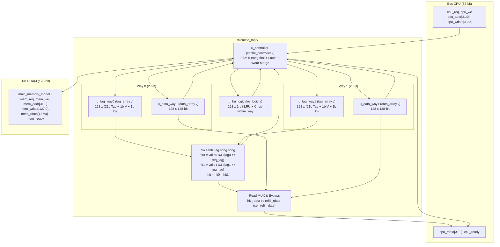

# Tài Liệu 02: Thiết Kế Vi Kiến Trúc Phần Cứng RTL & Máy Trạng Thái FSM

Tài liệu này giải thích chi tiết từng file mã nguồn Verilog trong thư mục [`rtl/`](../rtl/) theo góc nhìn mạch số (Datapath + Control Path), giúp sinh viên đọc hiểu luồng dữ liệu, cơ chế chốt thanh ghi, máy trạng thái **FSM 5 trạng thái** và bảng định thời từng chu kỳ xung nhịp.

> **Lưu ý ranh giới mã nguồn:** Toàn bộ các file trong [`rtl/`](../rtl/) được viết theo chuẩn **Synthesizable Verilog** (có thể tổng hợp thành mạch phần cứng thật trên FPGA/ASIC). Các file trong [`sim/`](../sim/) dùng cấu trúc hành vi (`initial`, `#delay`, `$display`, `$dumpfile`) chỉ để giả lập DRAM và chạy kiểm thử.

---

## Mục Lục
1. [Bức Tranh Tổng Thể & Module Đỉnh (`cache_top.v`)](#1-bức-tranh-tổng-thể--module-đỉnh-cache_topv)
2. [Giải Thích 4 Khối Datapath Cốt Lõi](#2-giải-thích-4-khối-datapath-cốt-lõi)
3. [Máy Trạng Thái FSM 5 Trạng Thái (`cache_controller.v`)](#3-máy-trạng-thái-fsm-5-trạng-thái-cache_controllerv)
4. [Theo Dõi Từng Chu Kỳ (Cycle-by-Cycle) & Chống Giao Dịch Ảo](#4-theo-dõi-từng-chu-kỳ-cycle-by-cycle--chống-giao-dịch-ảo)

---

## 1. Bức Tranh Tổng Thể & Module Đỉnh (`cache_top.v`)

Trong thiết kế vi mạch số, phần cứng thường chia làm 2 phần:
- **Datapath (Đường dữ liệu):** Nơi lưu trữ và biến đổi dữ liệu (`tag_array`, `data_array`, `lru_logic`, bộ so sánh Tag, bộ chọn kênh MUX).
- **Control Path (Đường điều khiển):** Bộ não ra quyết định khi nào đọc, khi nào ghi, khi nào chờ DRAM (`cache_controller`).

Module đỉnh [`rtl/cache_top.v`](../rtl/cache_top.v) ghép nối 6 module con (`u_tag_way0`, `u_data_way0`, `u_tag_way1`, `u_data_way1`, `u_lru_logic`, `u_controller`) với bus CPU và bus DRAM:



### 1.1. Bảng đặc tả cổng vào/ra của `cache_top`

| Nhóm | Tín hiệu | Chiều | Số bit | Vai trò dễ hiểu |
| :--- | :--- | :---: | :---: | :--- |
| **Hệ thống** | `clk` | Vào | 1 | Xung nhịp đồng bộ toàn mạch |
| | `rst_n` | Vào | 1 | Reset mức thấp (`0`: xóa hết Cache và đưa FSM về `IDLE`) |
| **Giao tiếp CPU** | `cpu_req` | Vào | 1 | `1` khi CPU muốn đọc hoặc ghi |
| | `cpu_we` | Vào | 1 | `0`: Lệnh Đọc (Load); `1`: Lệnh Ghi (Store) |
| | `cpu_addr` | Vào | 32 | Địa chỉ byte cần truy cập |
| | `cpu_wdata` | Vào | 32 | Dữ liệu CPU muốn ghi (chỉ dùng khi `cpu_we = 1`) |
| | `cpu_rdata` | Ra | 32 | Dữ liệu trả về CPU (chỉ hợp lệ khi `cpu_ready = 1`) |
| | `cpu_ready` | Ra | 1 | `1`: Xong lệnh; `0`: Cache đang bận, CPU phải đứng chờ (Stall) |
| **Giao tiếp DRAM** | `mem_req` | Ra | 1 | `1`: Cache đang yêu cầu DRAM phục vụ |
| | `mem_we` | Ra | 1 | `0`: Đọc 16B từ DRAM lên; `1`: Ghi trả 16B từ Cache xuống DRAM |
| | `mem_addr` | Ra | 32 | Địa chỉ dòng 16B căn chỉnh (`4 bit thấp = 4'b0000`) |
| | `mem_wdata` | Ra | 128 | Cả dòng 128-bit bẩn gửi xuống DRAM khi Write-Back |
| | `mem_rdata` | Vào | 128 | Cả dòng 128-bit đọc từ DRAM trả lên |
| | `mem_ready` | Vào | 1 | Xung `1` đúng 1 chu kỳ báo DRAM đã xử lý xong |
| **Đo đạc / Debug** | `hit_out`, `miss_out` | Ra | 1, 1 | Nháy lên `1` tại `COMPARE_TAG` để Testbench đếm Hit/Miss |
| | `state_out` | Ra | 3 | Cho biết FSM đang ở trạng thái nào (`0`..`4`) |

### 1.2. Ba điểm thiết kế thông minh ngay tại `cache_top.v`

1. **Bảo vệ chỉ số Set (`current_index`, `current_word_idx`):**
   ```verilog
   wire [INDEX_WIDTH-1:0] current_index = (state_out == `STATE_IDLE) ?
                                          cpu_addr[`INDEX_MSB:`INDEX_LSB] :
                                          latched_addr[`INDEX_MSB:`INDEX_LSB];
   ```
   - Khi đang rảnh (`STATE_IDLE`), Cache dùng luôn `cpu_addr` để đọc sẵn dữ liệu từ SRAM.
   - Ngay khi bước vào xử lý (`state_out != STATE_IDLE`), Cache chuyển sang dùng `latched_addr` (địa chỉ đã chốt). Nhờ vậy, nếu CPU lỡ đổi giá trị trên dây `cpu_addr` trong lúc bị Stall, các mảng SRAM vẫn giữ nguyên đúng Set đang xử lý.

2. **So sánh Tag song song cả 2 Way:**
   ```verilog
   wire [TAG_WIDTH-1:0] req_tag = latched_addr[`TAG_MSB:`TAG_LSB];
   wire hit0    = valid0 && (tag0 == req_tag);
   wire hit1    = valid1 && (tag1 == req_tag);
   wire hit     = hit0 || hit1;
   wire hit_way = hit1;
   ```
   Cả `Way 0` và `Way 1` được đọc và so sánh cùng một lúc. Vì một địa chỉ không thể nằm ở cả 2 Way cùng lúc, nếu `hit == 1` thì hoặc `hit0 == 1` (`hit_way = 0`), hoặc `hit1 == 1` (`hit_way = 1`).

3. **Mạch Bypass `sel_refill_data` (Tiết kiệm 1 chu kỳ khi Miss):**
   ```text
   Không có Bypass: [FETCH_MEM xong] -> [REFILL: ghi vào SRAM] -> [Chu kỳ sau: đọc SRAM ra CPU] (Tốn thêm 1 chu kỳ!)
   Có Bypass:       [FETCH_MEM xong] -> [REFILL: vừa ghi vào SRAM, vừa nối thẳng refill_rdata ra cpu_rdata] (Nhanh hơn!)
   ```
   Nhờ thanh ghi `data_mem` ghi theo sườn lên cuối chu kỳ `STATE_REFILL_UPDATE`, nếu `cpu_rdata` chỉ nối với `data_array` thì phải đợi sang chu kỳ kế tiếp mới có dữ liệu mới. Mạch bypass tách 32-bit trực tiếp từ `refill_line` đưa thẳng ra `cpu_rdata` ngay khi `sel_refill_data = 1`.

---

## 2. Giải Thích 4 Khối Datapath Cốt Lõi

### 2.1. Tham số hóa hệ thống ([`rtl/cache_defines.vh`](../rtl/cache_defines.vh))
Tập trung toàn bộ hằng số tại 1 file header (`ADDR_WIDTH=32`, `DATA_WIDTH=32`, `LINE_WIDTH=128`, `NUM_SETS=128`, `TAG_WIDTH=21`, `INDEX_WIDTH=7`, `WORD_SEL_WIDTH=2`) và mã hóa 5 trạng thái FSM. Mọi module khác đều `` `include "cache_defines.vh" `` để đồng bộ tuyệt đối về độ rộng bus.

### 2.2. Mảng Thẻ Địa Chỉ ([`rtl/tag_array.v`](../rtl/tag_array.v))
Đại diện cho phần quản lý siêu dữ liệu của **1 Way** (cần 2 bản thể hiện: `u_tag_way0` và `u_tag_way1`):
- Lưu 3 mảng 128 phần tử: `tag_mem` (`21-bit`), `valid_mem` (`1-bit`), `dirty_mem` (`1-bit`).
- **Tại sao đọc là mạch tổ hợp (`assign`) còn ghi là mạch tuần tự (`posedge clk`)?**
  - **Đọc tổ hợp** giúp vừa bước sang `STATE_COMPARE_TAG` là có ngay `tag_out`, `valid_out`, `dirty_out` để so sánh Hit/Miss trong 1 chu kỳ.
  - **Ghi đồng bộ** đảm bảo chỉ cập nhật dữ liệu sạch sẽ tại sườn lên clock, tránh lỗi nhiễu/glitch tổ hợp làm hỏng nội dung Cache.
- Khi `tag_we = 1` (lúc nạp dòng mới), module tự động bật luôn `valid_mem[index] <= 1'b1`.

### 2.3. Mảng Dữ Liệu ([`rtl/data_array.v`](../rtl/data_array.v))
Mỗi Way lưu `128 dòng × 128-bit = 2 KB` (2 Way cộng lại = `4 KB`). Điểm đặc biệt của module này là **hỗ trợ 2 độ rộng ghi khác nhau**:
- **Ghi cả dòng (`line_we = 1`):** Dùng khi Miss, chép toàn bộ 128-bit `line_in` vào `data_mem[index]`.
- **Ghi chọn lọc 1 Word (`word_we = 1`):** Dùng khi Write Hit, cắt lát đúng 32-bit theo `word_idx` (`[31:0]`, `[63:32]`, `[95:64]`, `[127:96]`) để ghi `word_in`, giữ nguyên 3 Word còn lại trong dòng.

```text
Một dòng 128-bit trong data_mem[index]:
+------------------+------------------+------------------+------------------+
|  Word 3 [127:96] |  Word 2 [95:64]  |  Word 1 [63:32]  |  Word 0 [31:0]   |
+------------------+------------------+------------------+------------------+
  word_idx = 2'b11   word_idx = 2'b10   word_idx = 2'b01   word_idx = 2'b00
```

- Hai cổng đọc tổ hợp luôn sẵn sàng: `line_out` (128-bit để đẩy về DRAM khi Write-Back) và `word_out` (32-bit qua bộ chọn 4-sang-1 để trả cho CPU).

### 2.4. Khối Quản Lý True LRU ([`rtl/lru_logic.v`](../rtl/lru_logic.v))
- Dùng mảng 128 bit `lru_mem[0:127]`. Quy ước: `0` = Way 0 là LRU; `1` = Way 1 là LRU.
- **Chọn nạn nhân (`victim_way`):** Kiểm tra lần lượt:
  1. `valid0 == 0` $\to$ chọn `Way 0` (ưu tiên lấp chỗ trống trước).
  2. `valid1 == 0` $\to$ chọn `Way 1`.
  3. Cả 2 Way đã có dữ liệu $\to$ chọn `lru_bit`.
- **Cập nhật (`lru_update = 1`):** Khi truy cập trúng hoặc vừa nạp xong Way nào (`access_way`), đánh dấu Way kia thành LRU (`lru_mem[index] <= ~access_way`).

---

## 3. Máy Trạng Thái FSM 5 Trạng Thái (`cache_controller.v`)

File [`rtl/cache_controller.v`](../rtl/cache_controller.v) điều khiển toàn bộ hoạt động Cache qua 5 trạng thái:

```mermaid
stateDiagram-v2
    [*] --> STATE_IDLE : rst_n = 0
    STATE_IDLE --> STATE_IDLE : cpu_req = 0
    STATE_IDLE --> STATE_COMPARE_TAG : cpu_req = 1\n(Chốt cpu_addr, cpu_wdata, cpu_we)

    STATE_COMPARE_TAG --> STATE_IDLE : hit = 1\n(cpu_ready = 1, cập nhật LRU;\nnếu Write Hit: bật word_we & Dirty = 1)
    STATE_COMPARE_TAG --> STATE_FETCH_MEM : hit = 0 && victim_dirty = 0\n(Nạn nhân sạch/trống -> Bỏ qua Write-Back)
    STATE_COMPARE_TAG --> STATE_WRITE_BACK : hit = 0 && victim_dirty = 1\n(Nạn nhân bẩn -> Ghi trả DRAM trước)

    STATE_WRITE_BACK --> STATE_WRITE_BACK : mem_ready = 0
    STATE_WRITE_BACK --> STATE_FETCH_MEM : mem_ready = 1\n(Ghi trả xong 128-bit)

    STATE_FETCH_MEM --> STATE_FETCH_MEM : mem_ready = 0
    STATE_FETCH_MEM --> STATE_REFILL_UPDATE : mem_ready = 1\n(Chốt latched_mem_rdata)

    STATE_REFILL_UPDATE --> STATE_IDLE : Nạp xong Cache\n(Ghi Tag/Valid/Dirty/Line, cập nhật LRU,\nsel_refill_data = 1, cpu_ready = 1)
```



### 3.1. Tại sao cần các thanh ghi chốt (`latched_*`)?
- **`latched_addr`, `latched_wdata`, `latched_we` (chốt ở `IDLE` khi `cpu_req = 1`):** Giữ cố định thông tin lệnh của CPU trong suốt thời gian xử lý Miss.
- **`latched_victim_way`, `latched_victim_tag`, `latched_victim_data` (chốt ở `COMPARE_TAG` khi `!hit`):** Khi bắt đầu đi xử lý Miss, thông tin của dòng nạn nhân (đặc biệt là `Tag` cũ và `128-bit` dữ liệu cũ) được khóa chặt vào thanh ghi để gửi xuống DRAM trong `STATE_WRITE_BACK`, không lo bị ảnh hưởng nếu đường đọc SRAM thay đổi.
- **`latched_mem_rdata` (chốt ở `FETCH_MEM` khi `mem_ready = 1`):** Giữ ổn định khối 128-bit DRAM vừa trả về để sang chu kỳ `STATE_REFILL_UPDATE` ghi vào `data_array` và trả ra `cpu_rdata`.

### 3.2. Cách `merged_line` xử lý Write-Allocate khi Write Miss
Khi CPU muốn ghi 1 Word (`0xDEAD_BEEF`) vào địa chỉ chưa có trong Cache (`0x0000_2000`, `Word 0`):
1. `STATE_FETCH_MEM` đọc cả dòng 128-bit từ DRAM lên (`W3 | W2 | W1 | W0_cũ`).
2. Mạch tổ hợp `merged_line` giữ nguyên `W3, W2, W1` và chỉ thay thế `W0` bằng `latched_wdata` (`0xDEAD_BEEF`).
3. Sang `STATE_REFILL_UPDATE`, toàn bộ dòng đã trộn này được ghi vào `data_array` và cờ `Dirty` được bật lên `1` (vì bản trong Cache đã khác DRAM).

### 3.3. Cách tái tạo địa chỉ khi Write-Back
Do `tag_array` chỉ lưu 21 bit `Tag` (không lưu 7 bit `Index`), khi ghi trả dòng nạn nhân về DRAM ở `STATE_WRITE_BACK`, controller ghép lại địa chỉ 32-bit đầy đủ bằng câu lệnh:
```verilog
mem_addr = {latched_victim_tag, latched_addr[`INDEX_MSB:`INDEX_LSB], 4'b0000};
```
- `21 bit` cao lấy `Tag` của dòng nạn nhân cũ (`latched_victim_tag`), **không phải** `Tag` của địa chỉ CPU đang yêu cầu!
- `7 bit` giữa lấy `Index` của Set hiện tại (`latched_addr[10:4]`).
- `4 bit` thấp gán `4'b0000` để căn chỉnh đúng đầu dòng 16-byte.

### 3.4. Bảng tín hiệu điều khiển theo từng trạng thái

| Trạng thái | `cpu_ready` | `mem_req` / `mem_we` | Các tín hiệu ghi SRAM & LRU |
| :--- | :---: | :---: | :--- |
| `STATE_IDLE` | `0` | `0` / `0` | Không ghi |
| `STATE_COMPARE_TAG` (Read Hit) | `1` | `0` / `0` | `lru_update = 1`, `lru_access_way = hit_way` |
| `STATE_COMPARE_TAG` (Write Hit) | `1` | `0` / `0` | `word_we[hit_way] = 1`, `dirty_we = 1`, `dirty_in = 1`, `lru_update = 1` |
| `STATE_COMPARE_TAG` (Miss) | `0` | `0` / `0` | Không ghi (chốt Victim vào thanh ghi) |
| `STATE_WRITE_BACK` | `0` | `~mem_ready` / `1` | Không ghi (xuất `mem_addr` nạn nhân và `mem_wdata`) |
| `STATE_FETCH_MEM` | `0` | `~mem_ready` / `0` | Không ghi (xuất `mem_addr` mới) |
| `STATE_REFILL_UPDATE` (Read Miss) | `1` | `0` / `0` | `tag_we = 1`, `dirty_we = 1`, `dirty_in = 0`, `line_we = 1`, `lru_update = 1`, `sel_refill_data = 1` |
| `STATE_REFILL_UPDATE` (Write Miss) | `1` | `0` / `0` | `tag_we = 1`, `dirty_we = 1`, `dirty_in = 1`, `line_we = 1`, `lru_update = 1`, `Dirty <= 1` |

---

## 4. Theo Dõi Từng Chu Kỳ (Cycle-by-Cycle) & Chống Giao Dịch Ảo

Để hiểu chắc chắn vì sao độ trễ của hệ thống luôn đúng **`1` chu kỳ (Hit)**, **`10` chu kỳ (Clean Miss)** và **`18` chu kỳ (Dirty Miss)**, hãy theo dõi từng chu kỳ xung nhịp khi chạy với [`sim/main_memory_model.v`](../sim/main_memory_model.v) (`LATENCY_CYCLES = 6`):

### 4.1. Bảng theo dõi từng chu kỳ cho 1 lần Clean Miss (`10 chu kỳ`)

| Chu kỳ đo | Trạng thái FSM (`state`) | Tín hiệu phía DRAM (`busy`, `latency_counter`, `mem_ready`) | Tín hiệu bus (`mem_req`, `cpu_ready`) | Sự kiện tại sườn lên kết thúc chu kỳ |
| :---: | :--- | :--- | :---: | :--- |
| *(Phát lệnh)* | `STATE_IDLE` | `busy=0, cnt=0, mem_ready=0` | `mem_req=0, cpu_ready=0` | Testbench đặt `cpu_req=1`; FSM chốt lệnh $\to$ sang `COMPARE_TAG` |
| **1** | `COMPARE_TAG` | `busy=0, cnt=0, mem_ready=0` | `mem_req=0, cpu_ready=0` | `hit=0, victim_dirty=0` $\to$ chốt Victim, sang `FETCH_MEM` |
| **2** | `FETCH_MEM` | `busy=0, cnt=0, mem_ready=0` | **`mem_req=1`**, `cpu_ready=0` | DRAM thấy `mem_req=1` $\to$ đặt `busy<=1, cnt<=1` |
| **3** | `FETCH_MEM` | `busy=1, cnt=1, mem_ready=0` | `mem_req=1, cpu_ready=0` | `cnt < 6` $\to$ tăng `cnt <= 2` |
| **4** | `FETCH_MEM` | `busy=1, cnt=2, mem_ready=0` | `mem_req=1, cpu_ready=0` | `cnt < 6` $\to$ tăng `cnt <= 3` |
| **5** | `FETCH_MEM` | `busy=1, cnt=3, mem_ready=0` | `mem_req=1, cpu_ready=0` | `cnt < 6` $\to$ tăng `cnt <= 4` |
| **6** | `FETCH_MEM` | `busy=1, cnt=4, mem_ready=0` | `mem_req=1, cpu_ready=0` | `cnt < 6` $\to$ tăng `cnt <= 5` |
| **7** | `FETCH_MEM` | `busy=1, cnt=5, mem_ready=0` | `mem_req=1, cpu_ready=0` | `cnt < 6` $\to$ tăng `cnt <= 6` |
| **8** | `FETCH_MEM` | `busy=1, cnt=6, mem_ready=0` | `mem_req=1, cpu_ready=0` | `cnt == 6` $\to$ DRAM đặt `busy<=0, mem_ready<=1`, xuất `mem_rdata` |
| **9** | `FETCH_MEM` | `busy=0, cnt=0,` **`mem_ready=1`** | **`mem_req=0`** *(`~mem_ready`)* | FSM thấy `mem_ready=1` $\to$ chốt `latched_mem_rdata`, sang `REFILL_UPDATE` |
| **10** | `REFILL_UPDATE` | `busy=0, cnt=0, mem_ready=0` | `mem_req=0,` **`cpu_ready=1`** | Ghi Tag/Data/LRU, CPU đọc xong `cpu_rdata` $\to$ về `IDLE` |

**Nhận xét rút ra từ bảng trên:**
- Nếu **Hit**: chỉ cần **Chu kỳ 1** (`COMPARE_TAG` có `cpu_ready = 1`) $\implies$ **1 chu kỳ**.
- Một pha giao tiếp DRAM (`FETCH_MEM` hoặc `WRITE_BACK`) luôn chiếm từ **Chu kỳ 2 đến Chu kỳ 9 = `8 chu kỳ`**.
- **Clean Miss** = `1` (`COMPARE_TAG`) + `8` (`FETCH_MEM`) + `1` (`REFILL_UPDATE`) = **10 chu kỳ**.
- **Dirty Miss** = `1` (`COMPARE_TAG`) + `8` (`WRITE_BACK`) + `8` (`FETCH_MEM`) + `1` (`REFILL_UPDATE`) = **18 chu kỳ**.

### 4.2. Vì sao cần `mem_req = ~mem_ready` ở Chu kỳ 9? (Chống giao dịch ảo)
Hãy nhìn lại **Chu kỳ 9** trong bảng trên:
- Lúc này DRAM vừa xong việc nên đã hạ `busy = 0` và bật `mem_ready = 1`.
- Trong suốt chu kỳ 9, thanh ghi `state` của `cache_controller` vẫn đang ở `STATE_FETCH_MEM` (hoặc `STATE_WRITE_BACK`) chờ sườn lên cuối chu kỳ 9 mới chuyển trạng thái.
- Nếu ở trạng thái này ta gán cứng `mem_req = 1'b1` thay vì `~mem_ready`, thì tại sườn lên cuối chu kỳ 9, DRAM nhìn thấy `busy == 0 && mem_req == 1` nên lại tưởng có yêu cầu mới và chạy thêm một giao dịch thừa (**Phantom Transaction**).
- Nhờ 2 lớp bảo vệ:
  1. `cache_controller.v` xuất `mem_req = ~mem_ready;` (hạ ngay `mem_req` về `0` ở chu kỳ 9).
  2. `main_memory_model.v` kiểm tra `if (mem_req && !mem_ready)` khi `!busy`.
  Giao dịch DRAM kết thúc dứt khoát và đồng bộ tuyệt đối ở mọi kịch bản.
